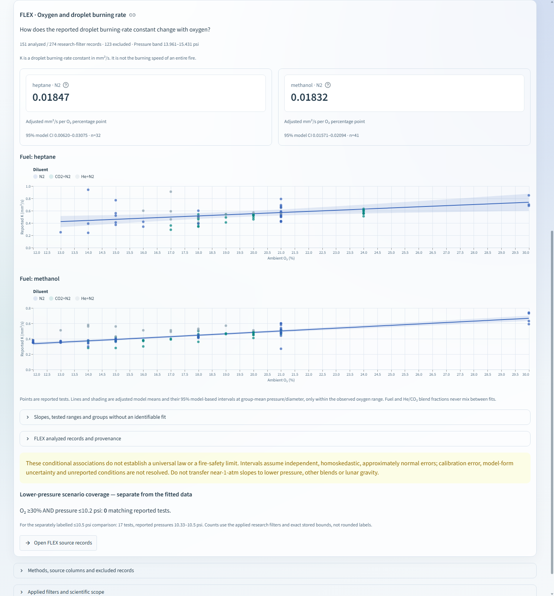
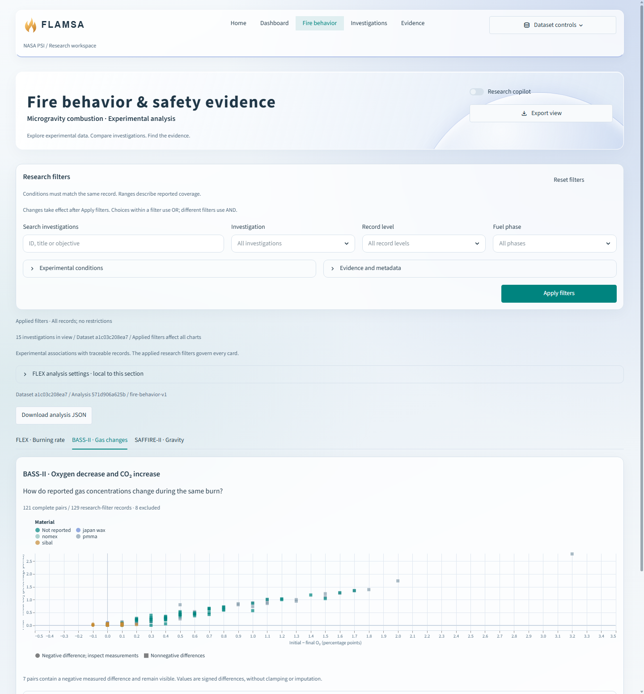
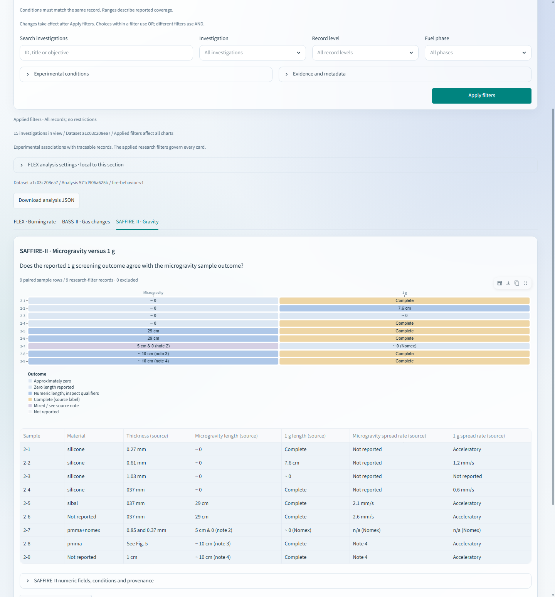
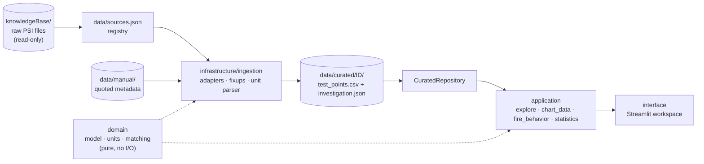

<div align="center">


### NASA microgravity combustion data, organized for fire-safety work in crewed habitats


15 investigations associated with ISS research and 1,615 curated records, each traceable to the cell, page or quote it came from.

</div>

<p align="center">
  
</p>

---

## Contents
1. [Why FLAMSA](#why-flamsa)
2. [The dashboard](#the-dashboard)
3. [The data](#the-data)
4. [Physical consistency rules](#physical-consistency-rules)
5. [The lunar-habitat question](#the-lunar-habitat-question)
6. [Architecture](#architecture)
7. [Quick start](#quick-start)
8. [Known limits](#known-limits)
9. [Repository map](#repository-map)
10. [References](#references)

---

## Why FLAMSA

Fire behaves differently on a spacecraft, a station, a lunar or Martian base or a pressurized rover than it does on Earth. Microgravity strongly suppresses buoyant flow, making diffusion and ventilation important to flame behavior. Lunar and Martian gravity are different again. Exploration-habitat scenarios may combine reduced pressure with enriched oxygen; applicability must be checked against the tested conditions.

NASA's [Physical Sciences Informatics (PSI)](https://psi.nasa.gov) archive has years of ISS combustion experiments, spread across spreadsheets, ISA-Tab folders and PDF reports in different formats. We built FLAMSA to make that material usable for fire-safety questions. In practice that meant four jobs:

- **Curation.** Each investigation is mapped to a common schema with canonical units, and the original cell text is kept next to every normalized value.
- **Checks against physics.** Each table is tested against relations stated in its own reports. Values that cannot be physically right are set aside with a note instead of being quietly corrected.
- **Exploration.** The dashboard filters, compares and fits the data, and shows what it excluded and why.
- **Citation.** Claims point to an archived file, a page and a quote that can be found with Ctrl+F.

We do not fill gaps. A missing value stays missing, an inferred one is marked as inferred with the reason, and the source string is always kept.

---

## The dashboard

The workspace has four destinations. One set of research filters drives the analysis views: investigation, record level, fuel phase, O₂/pressure/flow intervals, review state, hardware, sensors and fire-safety pillar. Sources are available within Investigations under Citations & source downloads.

| Destination | Contents |
|---|---|
| **Home** | Interactive chamber scene with four entry points (flame behavior, Earth applications, exploration habitats, detection and diagnostics) and live archive counts. |
| **Dashboard** | KPI cards, a scatter of reported tests for any compatible pair of quantities, records per investigation, and reported O₂/pressure/flow envelopes. Every omitted record has a stated reason. |
| **Fire behavior** | Three source-bounded analyses: FLEX burning rate vs O₂ (adjusted slopes with 95% intervals), BASS-II O₂ consumed vs CO₂ produced, and SAFFIRE-II microgravity vs 1 g outcomes. Exports reproducible JSON and CSV. |
| **Investigations** | Catalog, objective, review status, sensors and hardware with quotes, a full TestPoint table, raw values/provenance and Citations & source downloads with locators and checksums. |

<table>
<tr>
<td width="50%"><br><sub><b>Fire behavior · FLEX.</b> Burning-rate constant vs O₂ per fuel, colored by diluent, with the adjusted slope and its 95% interval.</sub></td>
<td width="50%"><br><sub><b>Fire behavior · BASS-II.</b> O₂ consumed vs CO₂ produced in the same burn. Signed concentration changes are shown without a fitted stoichiometric line.</sub></td>
</tr>
<tr>
<td width="50%"><br><sub><b>Dashboard.</b> Filters apply to every card. The chart lists the investigations that have no plottable pair and the reason.</sub></td>
<td width="50%"><br><sub><b>Fire behavior · SAFFIRE-II.</b> Raw microgravity and 1 g outcomes side by side. Labels such as "Complete" and "Acceleratory" stay as text.</sub></td>
</tr>
</table>

> The Research copilot panel is in the layout but marked *Not connected*. Scenario ranking and the LLM explanation with checked citations come next (see [Known limits](#known-limits)).

---

## The data

| Investigation | PSI | Phase | Fuels (curated names) | Records |
|---|---|---|---|---:|
| **FLEX** | PSI-69 | liquid droplets | heptane, methanol | 274 |
| **FLEX-2** | PSI-68 | liquid droplets | decane, ethanol, heptane, iso-octane, n-octane and blends | 8 (test matrix) |
| **CFI** | PSI-39 | liquid droplets | n-dodecane, n-dodecane + iso-dodecane | 87 |
| **ACME-CFI-G** | PSI-159 | gas, spherical burner | ethane, propane, butane | 333 |
| **ACME-BRE** | PSI-20 | gas | ethylene, methane | 18 (test days) |
| **ACME-E-FIELD** | PSI-22 | gas, electric field | ethylene, methane | 21 (test days) |
| **SPICE** | PSI-107 | gas jet in coflow | ethylene, methane, propane, propylene (pure and N₂-diluted) | 469 |
| **SLICE** | PSI-106 | gas jet | ethane, ethylene, methane | 12 (test days) |
| **BASS** | PSI-26 | solid | PMMA, SIBAL, Nomex, Ultem, waxes | 122 |
| **BASS-II** | PSI-25 | solid | PMMA, SIBAL, Nomex, Japan wax | 129 |
| **SAFFIRE-I / II / III** | PSI-98 / 99 / 100 | solid, large scale | SIBAL, PMMA, silicone, PMMA + Nomex | 2 / 9 / 2 |
| **SAME** | PSI-102 | solid, smoke | Kapton, Teflon, silicone rubber, lampwick, DBP | 20 |
| **SAME-R** | PSI-101 | solid, smoke | Kapton, Teflon, silicone rubber, lampwick, Pyrell | 109 |
| | | | **Total** | **1,615** |

Curation rules:
- Units are part of the column name: `pressure_psi`, `o2_percent`, `flow_speed_cm_s`, length in `mm`, time in `s`. Conversions are named constants, for example 1 mmHg = 0.0193368 psi.
- `<column>_raw` keeps the source string whenever it differs from the normalized value.
- Each row records its source file (resolved through `data/sources.json`), source row, `provenance_status ∈ {verified, inferred, missing}` and a `provenance_note`.
- Each hand-curated claim cites one printed line or one DOCX paragraph and is verified mechanically against the archived file.
- The output is one folder per investigation, `data/curated/<ID>/test_points.csv` plus `investigation.json`. Both load directly into pandas or any other tool.

---

## Physical consistency rules

The relations below have different roles: approximate physical models, deterministic calculations, automated regression checks and documentary context. Tests in [`tests/infrastructure/test_physical_consistency.py`](tests/infrastructure/test_physical_consistency.py) run when pytest is invoked; they are not automatically executed by curation or every dashboard load. Passing these checks can reveal consistency and catch some mapping/unit errors, but does not establish every measurement as correct. [Formula audit and implementation map](docs/formula-audit.md) records which relations the interface actually calculates.

Quotes are copied exactly from the archived file. The numbers in brackets point to the [References](#references).

### R1 · Check the approximate d² model (FLEX)

In the idealized quasi-steady model, the squared droplet diameter decreases at constant rate K. The diameter itself does not decrease linearly:

```math
d(t)^2 \;=\; d_0^{\,2} \;-\; K\,t
\qquad\Longrightarrow\qquad
t_b \;=\; \frac{d_0^{\,2} - d_e^{\,2}}{K}
```

Here $`d_0`$ is the initial diameter, $`d_e`$ the reported diameter at flame extinction, $`K`$ the burning-rate constant in mm²/s, and $`t_b`$ the burn time. A reported physical burnout diameter can be zero; an unreported diameter is never replaced by zero.

FLEX reports $`d_0`$, $`d_e`$, $`K`$ and $`t_b`$ in separate columns, so the law can be tested directly against the table:

```math
\operatorname{median}\!\left(\frac{t_b^{\text{reported}}}{(d_0^{2}-d_e^{2})/K}\right) = 1.0492
\qquad (n = 155,\ \text{IQR } 1.0292\text{–}1.0773)
```

This checkpoint uses only finite reported diameters, K and burn time, with K > 0, burn time > 0 and d0 > 1.1 de. The 10% diameter-change screen is a numerical sensitivity policy, not a physical law. Missing extinction diameters are excluded, never set to zero. This check is executed in tests; the interface displays the physical model, not a newly calculated validation score. Some outliers can be flames that went out just after ignition ($`d_e \approx d_0`$); for those the denominator is close to zero.

> "diameter should decrease linearly with time with Ko being constant"
>
> Liu, Trenou, Rah, Hicks and Avedisian, *Effect of Varying the Initial Diameter of n-Octane and n-Decane Droplets over a Wide Range on the Spherically Symmetric Combustion Process* [1], p. 2. The paper measures n-octane and n-decane on the ISS and takes the law from Turns, *An Introduction to Combustion* [2].

The printed sentence says "diameter", but the displayed equation and normalized axes on that same page use squared diameter. The d² interpretation is the one used here; the source wording is preserved in the quotation.

### R2 · Estimate the oxygen association within comparable groups (FLEX)

Classical droplet theory links $`K`$ to the Spalding transfer number $`B`$, which grows with the ambient oxygen mass fraction $`Y_{O_2,\infty}`$:

```math
K \;=\; \frac{8\,\lambda_g}{\rho_\ell\,c_{p,g}}\,\ln\!\left(1 + B\right),
\qquad
B \;=\; \frac{c_{p,g}\,(T_\infty - T_s) \;+\; Y_{O_2,\infty}\,\Delta h_c/\nu}{h_{fg}}
\qquad\Longrightarrow\qquad
\frac{\partial K}{\partial Y_{O_2,\infty}} > 0
```

Here $`\lambda_g`$ and $`c_{p,g}`$ are the gas thermal conductivity and heat capacity, $`\rho_\ell`$ the liquid density, $`\Delta h_c`$ the positive heat-of-combustion magnitude, $`\nu`$ the stoichiometric O₂/fuel mass ratio and $`h_{fg}`$ the latent heat. $`T_\infty`$ and $`T_s`$ are ambient and droplet-surface temperatures.

This idealized expression holds other properties fixed. Its positive derivative is not a universal prediction across different fuels, pressures, diluents or extinction regimes. With SI inputs it gives K in m²/s (multiply by 10⁶ for mm²/s). The application does not evaluate this transfer-number model: its required thermophysical inputs are not mapped per test.

On the *Fire behavior → FLEX* tab, eligible fuel/diluent-blend groups near 1 atm receive a separate ordinary least-squares fit:

```math
K_i \;=\; \beta_0 \;+\; \beta_{O_2}\,X_{O_2,i} \;+\; \beta_P\,P_i \;+\; \beta_d\,d_{0,i} \;+\; \varepsilon_i,
\qquad
\hat\beta_{O_2} \;\pm\; t_{0.975,\;n-p}\;\operatorname{SE}\!\big(\hat\beta_{O_2}\big)
```

Pressure and initial diameter are included only when they vary within the group. A group is fitted when it has at least 6 tests, 3 distinct O₂ levels, 3 residual degrees of freedom, full design rank and a standardized condition number no higher than 10⁴. Here n counts observations and p counts fitted parameters, including the intercept. The 95% interval assumes independent, homoskedastic, normally distributed errors; it omits calibration and model-form uncertainty. With the current data:

| Stratum (≈ 1 atm) | n | $`\hat\beta_{O_2}`$ (mm²/s per O₂ point) | 95% interval | Tested O₂ |
|---|---:|---:|---|---|
| heptane · N₂ | 32 | **0.0185** | 0.0062 – 0.0307 | 13–30% |
| methanol · N₂ | 41 | **0.0183** | 0.0157 – 0.0209 | 12–30% |

Diluent groups remain separate. Differences between pooled medians would also reflect oxygen, pressure and initial-diameter coverage; those differences alone cannot identify a causal diluent or radiation effect.

> "The ambient oxygen mole fraction influences the burning rate, extinction diameter, flame chem-"
>
> Williams et al., *Science Requirements Document: Fundamental Studies in Droplet Combustion and Flame Extinguishment in Microgravity (FLEX-2)* [3], p. 42. The document does not give the sign of the effect; that comes from the theory above.

### R3 · Extinction diameter scales with initial diameter (FLEX)

```math
d_e \;\approx\; a + b\,d_0 \qquad (\text{conditional radiative-extinction trend})
```

This is a conditional trend for radiative extinction, not an enforced proportionality law or current automated test. A linear relationship need not pass through the origin. Fuel, atmosphere, soot formation and extinction regime matter; a pooled diameter correlation alone does not establish their separate effects.

A droplet that broke apart never reached an extinction diameter, so a `0` recorded for a *disruption* outcome is treated as missing (the raw `0` is kept).

> "Theory1 suggests a linear relationship between extinction diameter, de , and initial droplet diameter, d0"
>
> Hicks, Dietrich, Nayagam and Williams, *Dynamics of Water Absorption and Evaporation During Methanol Droplet Combustion in Microgravity* [4], slide 11. The "1" marks the slide's footnote to Zhang, Card and Williams, *Combustion and Flame* (1996).

### R4 · The stoichiometric mixture fraction follows from the composition (ACME-CFI-G)

For a fuel stream (mass fraction $`Y_F`$, balance N₂) facing an oxidizer stream (mass fraction $`Y_{O_2}`$, balance N₂):

```math
Z_{st} \;=\; \left(1 + \frac{s\,Y_F}{Y_{O_2}}\right)^{-1},
\qquad
s \;=\; \frac{\nu_{O_2}\,W_{O_2}}{W_F}
\quad
\left(\begin{array}{l}
\mathrm{C_2H_6}:\ s = 3.72\\
\mathrm{C_3H_8}:\ s = 3.63\\
\mathrm{C_4H_{10}}:\ s = 3.58
\end{array}\right),
\qquad
Y_k \;=\; \frac{X_k\,W_k}{X_k\,W_k + (1 - X_k)\,W_{N_2}}
```

We recomputed $`Z_{st}`$ from the reported O₂ and fuel mole fractions for all 331 flames, normal and inverse. The largest difference from the reported value is

```math
\max_i \left| Z_{st,i}^{\text{recomputed}} - Z_{st,i}^{\text{reported}} \right| \;\approx\; 4.081\times10^{-5}
```

That agreement would not survive a swapped or mis-converted oxygen or fuel column.

> "where Zst and Tad are respectively the stochiometric mixture fraction and adiabatic flame"
>
> Stocker, Sunderland, Axelbaum and Williams, *ACME/CFI-G Final Report: Advanced Combustion via Microgravity Experiments, Cool Flames Investigation with Gases* [5], p. 29.

### R5 · Check oxygen continuity within a chamber fill (ACME-CFI-G)

Oxygen consumption reduces the amount of O₂ in a sealed chamber. Mole fractions also depend on total gas moles, combustion products and gas exchange, so the first inequality below is a checked observation in this dataset, rather than a universal consequence of mass balance. The second describes continuity within an unchanged chamber fill:

```math
X_{O_2}^{\,\text{after}}(n) \;\le\; X_{O_2}^{\,\text{before}}(n),
\qquad
X_{O_2}^{\,\text{before}}(n+1) \;=\; X_{O_2}^{\,\text{after}}(n)
\quad\text{within one chamber fill}
```

The first relation holds for all 179 normal flames. The second holds to $`10^{-6}`$ in 156 of 168 consecutive same-day pairs; the other 12 differ, consistent with atmosphere resets; their individual cause is not established by the equality check alone. Within a test day, then, O₂ drifts down from test to test and should not be read as a freely chosen condition.

> "recirculation during CFI-G test operations was only conducted prior to venting: (1) at the end of a test day and/or (2) between atmospheres"
>
> Stocker et al., *ACME/CFI-G Final Report* [5], p. 19.

### R6 · Compare gas changes with complete-combustion stoichiometry (BASS-II)

PMMA burns as

```math
\mathrm{C_5H_8O_2} \;+\; 6\,\mathrm{O_2} \;\longrightarrow\; 5\,\mathrm{CO_2} \;+\; 4\,\mathrm{H_2O}
\qquad\Longrightarrow\qquad
\frac{\Delta n_{CO_2,\,produced}}{\Delta n_{O_2,\,consumed}} \;=\; \frac{5}{6} \;\approx\; 0.833
```

The 5/6 ratio applies to molar amounts for complete PMMA combustion. It is not automatically the ratio of measured concentration differences: that comparison also needs a common gas basis, approximately constant total gas amount and accounting for water condensation, incomplete combustion and measurement error.

For 24 complete PMMA reading pairs with an O₂ decrease strictly above 0.2 percentage points (allowing numerical roundoff), an exploratory least-squares slope through the origin of CO₂ concentration increase against O₂ concentration decrease is

```math
\widehat{\left(\frac{\Delta X_{CO_2}}{\Delta X_{O_2}}\right)}_{\mathrm{PMMA}} \;=\; 0.822
\qquad \text{(exploratory concentration fit, not a molar-balance validation)}
```

The production BASS-II chart shows signed same-test differences; it has no fitted stoichiometric line. The exploratory coefficient above has no reported uncertainty and is not an automated test or a safety threshold. In the curated pairs, CO₂ never falls by more than the sensor's reported 0.1 percentage-point resolution.

The size of the glovebox limits how much O₂ a burn can remove:

```math
m_{O_2} \;\approx\; \frac{\Delta X_{O_2,pp}}{100}\,\frac{P\,V}{R\,T}\,W_{O_2}
\;\approx\; 33\ \text{g for }\Delta X_{O_2} = 10\ \text{points in } V = 250\ \text{L}
\;\;\Rightarrow\;\; \approx 17\ \text{g of PMMA}
```

This illustrative estimate assumes P = 101325 Pa, T = 298.15 K, V = 0.250 m³, R = 8.314462618 J/(mol K), W(O₂) = 32 g/mol and approximately constant total gas amount. It gives 32.7 g O₂, equivalent to about 17 g PMMA under complete combustion. It is not a measured per-test mass or an acceptance limit.

Five final-O₂ readings (1.6, 0.6, 0.9, 39.1 and 40.4%) were flagged as suspect in the curation review and are missing with raw values retained (ADR-0080). The illustrative PMMA calculation does not establish the actual fuel mass or error mechanism for each of these mixed-material tests. Negative CO readings are also set aside; a sensor zero offset is a plausible interpretation, not a separately established cause for every reading.

> "The O2 decreased during each burn and the CO and CO2 increased accordingly."
>
> Olson, Ferkul, Bhattacharjee, Miller, Fernandez-Pello, Link, T'ien et al., *Burning and Suppression of Solids-II (BASS-II) Summary Report* [6], p. 14. The 250 L work volume is given on p. 87.

### R7 · Spread rate equals burned length over burn time (SAFFIRE-II)

```math
v_f \;=\; \frac{L_b}{t_b}
```

The source lists $`L_b`$, $`t_b`$ and $`v_f`$ in separate columns. $`290\,\text{mm}/145\,\text{s} = 0.20`$ cm/s against 0.21 reported, and $`290/115 = 0.25`$ cm/s against 0.26.

The SAFFIRE-II tab also shows the result the experiment was built to test. For silicone samples 2-1 and 2-4, the source reports Complete in 1 g and approximately zero flight burned length. Sample 2-2 instead reports 7.6 cm in 1 g and sample 2-3 approximately zero in both conditions. The matrix preserves these distinctions. The length/time relation is an average-speed consistency check (with mm converted to cm), not a law relating ground and flight outcomes or an imputed rate for Acceleratory/missing cells.

### R8 · Mass flow equals volume flow times gas density (SPICE)

```math
\dot m \;=\; \dot V\,\rho,
\qquad
\rho \;=\; \frac{P\,\overline{W}}{R\,T},
\qquad
\overline{W}_{\,75\%\,\mathrm{C_3H_6}/\mathrm{N_2}} \;=\; 0.75\,(42.08) + 0.25\,(28.01) \;=\; 38.56\ \mathrm{g\,mol^{-1}}
```

| Gas (at 101.325 kPa) | $`\rho`$ at 294 K (kg/m³) | $`\rho`$ at 300 K (kg/m³) | Implied by the source table before fixups (kg/m³) |
|---|---:|---:|---:|
| propylene | 1.743 | 1.709 | **1.709** |
| 50% propylene / N₂ | 1.452 | 1.424 | **1.423** |
| 75% propylene / N₂ | 1.598 | 1.567 | **1.566** (96 rows), 0.651 (36 rows) |
| methane | 0.665 | 0.652 | **0.651** |

For mass flow in mg/s and volume flow in sccm, the numerical value $`\rho = 60\,\dot m / \dot V`$ is in kg/m³ at the volumetric flow's reference state. The retained pairs imply nearly constant density for each gas, close to the ideal-gas value at 101.325 kPa and 300 K. The pressure and temperature used with sccm must match its stated reference conditions; this agreement does not establish the instrument's actual reference temperature or independently prove calibration.

36 rows labeled *75 % Propylene* give methane's density instead, which puts their mass flows about 2.4 times too low. Both mass-flow columns in those rows are treated as missing, with the raw values and a note kept; the volume flow is unchanged. We did not compute a replacement mass flow, since that would put a calculation where a measurement was.

> "75% propylene mixed with 25% nitrogen in moles, and 50% propylene mixed with 50% nitrogen in moles"
>
> Urban, Sunderland and Yuan, *Smoke Point in Co-flow Experiment (SPICE): Laminar Smoke Point Properties of Non-buoyant Round-Jet Diffusion Flames*, Final Report [7], p. 9.

### How violations are handled

| Situation | Action | Example |
|---|---|---|
| Source value is flagged as physically inconsistent in a documented review | Named adapter fixup sets it to missing, raw kept, row `inferred` with the reason | BASS-II final O₂ of 40.4% |
| Value contradicts another cell, and nothing settles which one is right | Value kept, conflict note added, row stays `verified` | ACME-CFI-G 21106 F4: "no hot ignition" with a 22 s burn |
| Composition does not close | Kept, with a note; never normalized | CFI r13–r16: O₂ + N₂ + He = 0.97 |
| Plausible fix, but the sources disagree | Kept missing until an archived source settles it | SAFFIRE-II thickness `037 mm` (NASA sources give 0.33, 0.36 or 0.37 mm) |

The full review is in [`docs/DATA_QUALITY_REVIEW.md`](docs/DATA_QUALITY_REVIEW.md), and the decisions are in [`docs/ADR.md`](docs/ADR.md) (ADR-0067 and ADR-0080).

---

## The lunar-habitat question

> *"Which microgravity evidence is relevant to a lunar base at ≥ 30% O₂ and ≤ 10.2 psi?"*

Before anything else, the data has to say how much of it applies. The *Dashboard* opens on this map: every test that reports both oxygen and pressure, with the scenario drawn as a box.

```math
\#\big\{\,\text{tests} : X_{O_2} \ge 30\%\ \wedge\ P \le 10.2\ \text{psi}\,\big\}
\;=\;
\underbrace{20}_{\substack{\text{ACME-CFI-G normal flames}\\ \text{O}_2\text{ in the chamber}}}
\;+\;
\underbrace{28}_{\substack{\text{ACME-CFI-G inverse flames}\\ \text{O}_2\text{ in the burner stream}}}
```

| Investigation | Tests with O₂ and pressure | In the scenario | Tested pressure | Tested O₂ |
|---|---:|---:|---|---|
| ACME-CFI-G | 333 | 20 + 28 | 7.18–48.0 psi | 12–85% |
| FLEX | 273 | 0 (17 at 10.33–10.50 psi) | 10.2–44.9 psi | 12–34% |
| CFI | 87 | 0 | 7.35–73.5 psi | 17–21% |

- The 20 scenario tests are gas flames (14 butane, 6 ethane), all at 7.35 psi with 33–39% O₂ in the chamber atmosphere. In the 28 inverse flames, the measured O₂ belongs to the gas leaving the burner, not to the atmosphere a crew would breathe.
- Of the 1,556 individual tests in the archive, 693 report both O₂ and pressure. The other twelve investigations report one of the two, or neither, as individual tests (FLEX-2 lists only a planned test matrix), so they cannot be placed on the map.
- The near-1 atm slopes from R2 are not extended to 10.2 psi.
- The PSI has no partial-gravity data, so microgravity and 1 g comparisons do not by themselves establish upper/lower bounds or a valid interpolation for lunar gravity.

---

## Architecture

The code follows Clean Architecture with domain-driven design, and dependencies point inward. Scores will be computed in the domain layer; the planned LLM step only describes them.



| Layer | Holds | Must not import |
|---|---|---|
| `domain` | `Investigation`, `TestPoint`, `Quantity`, `Provenance`, unit conversion, interval matching | pandas, Streamlit, LangGraph, I/O |
| `application` | Use cases, ports, chart projections, least-squares statistics | pandas, Streamlit |
| `infrastructure` | Source registry, CSV/ISA-Tab adapters, evidence verifier, repository | no restriction |
| `interface` | Streamlit composition root and views | business rules |

Every architectural decision, trade-off, bug and fix is logged in [`docs/ADR.md`](docs/ADR.md).

---

## Quick start

```bash
git clone https://github.com/Huarada/FLAMSA.git && cd FLAMSA
python -m pip install -e ".[dashboard,dev]"

# Optional: rebuild data/curated from knowledgeBase (the committed output is already up to date)
PYTHONPATH=src python -m psi_fire.interface.curate_cli

# Verify: lint, strict types on the domain, full test suite
ruff check . && mypy src/psi_fire/domain && pytest -q

# Run the dashboard at http://localhost:8501
streamlit run src/psi_fire/interface/app.py
```

No API key or internet connection is needed to explore the data. Python 3.11 or later. Verifying page-anchored quotes in PDFs additionally needs `pdftotext` (poppler).

To use the data in your own models, load `data/curated/*/test_points.csv`. Every column carries its unit, and `<column>_raw` and `provenance_*` let you filter by data quality. *Fire behavior* also exports each analysis as JSON and CSV, with the dataset revision and the record ids.

---

## Known limits

- There is no partial-gravity data in the PSI. E-FIELD uses electric fields to emulate partial gravity, which is not the same as lunar data.
- The slopes and intervals describe associations inside the tested ranges. They are not safety limits, and anything outside those ranges is an extrapolation.
- Not built yet: deterministic relevance ranking for a habitat scenario, citation-validated LLM narration (the copilot is shown as *Not connected*), and the one-click clean-dataset export bundle.
- Source defects we could not repair are documented, not patched: [`docs/DATA_QUALITY_REVIEW.md`](docs/DATA_QUALITY_REVIEW.md), [`docs/zip-removal-report.json`](docs/zip-removal-report.json).
- Rockets and propellants are out of scope.

---

## Repository map

```
knowledgeBase/        raw NASA PSI files (immutable)
data/
  sources.json        investigation id → raw files (the only place raw paths live)
  manual/             hand-curated metadata with 1:1 evidence quotes
  external/           archived external pages (HTML/PDF + SHA-256 + capture time)
  curated/<ID>/       test_points.csv + investigation.json  ← use these
src/psi_fire/
  domain/             entities, value objects, units (pure)
  application/        use cases, chart projections, fire-behavior statistics
  infrastructure/     ingestion adapters, repository, evidence verifier
  interface/          Streamlit workspace (app.py = composition root)
tests/                domain · application · infrastructure (incl. physics) · interface
docs/                 ADR log, data-quality review, dashboard and method notes, specs
```

Further reading: [dashboard guide](docs/dashboard.md) · [fire-behavior methods](docs/fire-behavior.md) · [data-quality review](docs/DATA_QUALITY_REVIEW.md) · [decision log](docs/ADR.md)

---

## References

The cited reports are archived in `knowledgeBase/`; reference [2] is a textbook cited by a report and is not archived here. Source passages support their specific statements, not every stronger inference in a section.

1. Y. C. Liu, K. N. Trenou, J. Rah, M. C. Hicks, C. T. Avedisian. *Effect of Varying the Initial Diameter of n-Octane and n-Decane Droplets over a Wide Range on the Spherically Symmetric Combustion Process: International Space Station and Ground-based Experiments.* 8th U.S. National Combustion Meeting, paper 070HE-0310, University of Utah, May 2013. `knowledgeBase/suppression/FLEX/2G11-070HE-0310.pdf`
2. S. R. Turns. *An Introduction to Combustion: Concepts and Applications*, 2nd ed. McGraw-Hill, 2000, p. 376. Cited by [1]; not archived here.
3. F. A. Williams (research team lead), D. L. Dietrich, M. C. Hicks, V. Nayagam et al. *Science Requirements Document: Fundamental Studies in Droplet Combustion and Flame Extinguishment in Microgravity (FLEX-2).* NASA. `knowledgeBase/suppression/FLEX2/FLEX-2 SRD Final.pdf`
4. M. C. Hicks, D. L. Dietrich, V. Nayagam, F. A. Williams. *Dynamics of Water Absorption and Evaporation During Methanol Droplet Combustion in Microgravity.* 28th Annual Meeting of the American Society for Space and Gravitational Research (as printed on the cover), Nov.–Dec. 2012. `knowledgeBase/suppression/FLEX/20130010979.pdf`
5. D. P. Stocker, P. B. Sunderland, R. L. Axelbaum, F. A. Williams. *ACME/CFI-G Final Report: Advanced Combustion via Microgravity Experiments (ACME), Cool Flames Investigation with Gases (CFI-G).* NASA Glenn Research Center, 21 November 2022. `knowledgeBase/ACME/CFI-G/PSI-159_Reports_FinalRpt_ACME.CFI-G.pdf`
6. S. L. Olson, P. V. Ferkul, S. Bhattacharjee, F. J. Miller, C. Fernandez-Pello, S. Link, J. S. T'ien, I. Wichman et al. *Burning and Suppression of Solids-II (BASS-II) Summary Report.* NASA/TM-20210011385. `knowledgeBase/Flammable/BASS2/BASS-II Summary Report.pdf`
7. D. L. Urban, P. B. Sunderland, Z.-G. Yuan. *Smoke Point in Co-flow Experiment (SPICE): Laminar Smoke Point Properties of Non-buoyant Round-Jet Diffusion Flames.* Final Report, 2 December 2011. `knowledgeBase/MSG (SolidAndGas)/SPICE/SPICE Final Report 12_2_2012.pdf`

---

<div align="center">
<sub>Built for the NASA Space Apps Challenge. Experimental data: NASA Physical Sciences Informatics (PSI). FLAMSA adds curation, verification and visualization, and makes no fire-safety certification.</sub>
</div>
