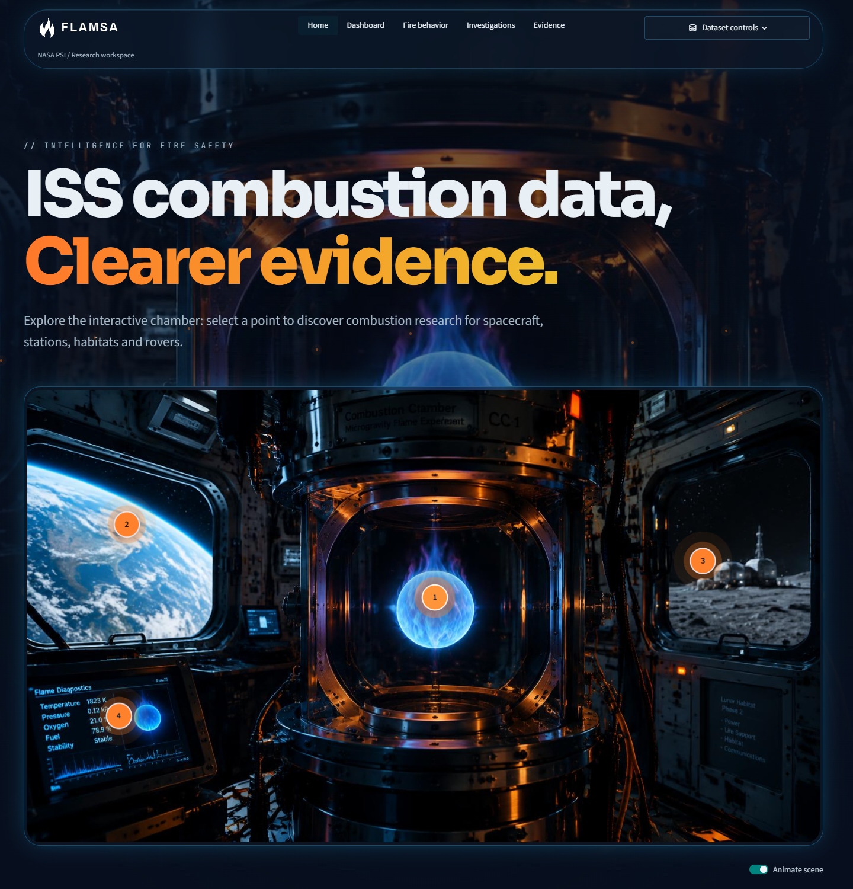
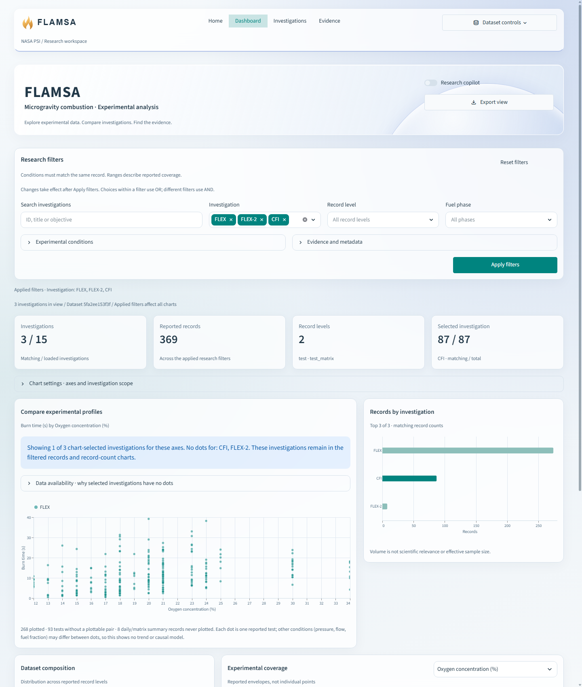
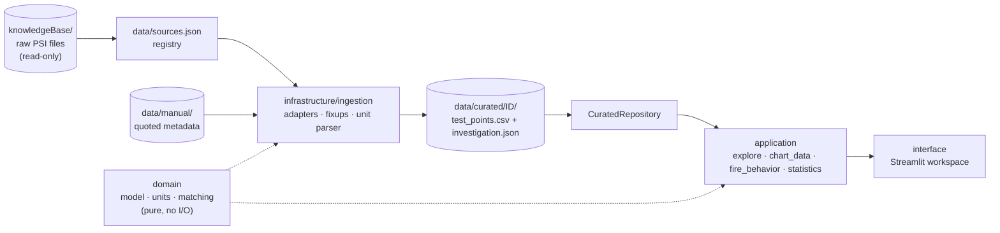

<div align="center">


### Explainable insights from NASA's microgravity combustion data, for fire safety in crewed habitats


**15 ISS investigations · 1,615 curated records · every value traceable to its source cell, page or quote**

</div>

<p align="center">
  
</p>

---

## Contents
1. [Why FLAMSA](#why-flamsa)
2. [What the dashboard does](#what-the-dashboard-does)
3. [The data](#the-data)
4. [Physics we verify: the business rules](#physics-we-verify-the-business-rules)
5. [The lunar-habitat question](#the-lunar-habitat-question)
6. [Architecture](#architecture)
7. [Quick start](#quick-start)
8. [Limits we state on purpose](#limits-we-state-on-purpose)
9. [Repository map](#repository-map)

---

## Why FLAMSA

A fire on a spacecraft, a station, a lunar or Martian base or a pressurized rover behaves differently from a fire on Earth. Without buoyancy there is no rising plume: oxygen reaches the flame only by diffusion or by forced ventilation. Exploration habitats are also expected to run at **lower pressure and higher oxygen** than the ISS, a combination that ground screening tests do not cover.

NASA's [Physical Sciences Informatics (PSI)](https://psi.nasa.gov) archive holds decades of microgravity combustion experiments, but as heterogeneous spreadsheets, ISA-Tab folders and PDF reports. **FLAMSA turns that archive into evidence an engineer can trust**:

| | |
|---|---|
| 🧹 **Curate** | 15 investigations normalized into one tidy schema with canonical units. The raw value is kept next to every normalized one. |
| 🔬 **Verify** | Every table is checked against the combustion laws stated in its own reports. Physically impossible values are isolated, never silently "fixed". |
| 📊 **Explore** | The dashboard filters, compares and fits only what the data supports, with intervals and exclusions shown. |
| 🔗 **Cite** | Every claim links to an archived source file, a page and a character-exact quote. |

> **Principle.** FLAMSA never invents a value. Missing stays missing, inferred is labeled *inferred* with a reason, and the original source string is always kept.

---

## What the dashboard does

The workspace has five destinations. One set of research filters drives all of them: investigation, record level, fuel phase, O₂/pressure/flow intervals, review state, hardware, sensors and fire-safety pillar.

| Destination | What you get |
|---|---|
| **Home** | Interactive chamber scene with four entry points (flame behavior, Earth applications, exploration habitats, detection and diagnostics) and live archive counts. |
| **Dashboard** | KPI cards, a scatter of reported tests for any compatible pair of quantities, records per investigation, and reported O₂/pressure/flow envelopes. Every omitted record has a stated reason. |
| **Fire behavior** | Three source-bounded analyses: FLEX burning rate vs O₂ (adjusted slopes with 95% intervals), BASS-II O₂ consumed vs CO₂ produced, and SAFFIRE-II microgravity vs 1 g outcomes. Exports reproducible JSON and CSV. |
| **Investigations** | Catalog, objective, review status, sensors and hardware with quotes, a full TestPoint table and a record inspector showing the raw value and provenance. |
| **Evidence** | Citations with page anchors and downloads of the archived source files, with checksums. |

<table>
<tr>
<td width="50%"><br><sub><b>Fire behavior · FLEX.</b> Burning-rate constant vs O₂ per fuel, colored by diluent, with the adjusted slope and its 95% interval.</sub></td>
<td width="50%"><br><sub><b>Fire behavior · BASS-II.</b> O₂ consumed vs CO₂ produced in the same burn: the stoichiometric line appears in the data.</sub></td>
</tr>
<tr>
<td width="50%"><br><sub><b>Dashboard.</b> Filters apply to every card. The chart says which investigations have no plottable pair, and why.</sub></td>
<td width="50%"><br><sub><b>Fire behavior · SAFFIRE-II.</b> Raw microgravity and 1 g outcomes side by side. "Complete" and "Acceleratory" are never turned into numbers.</sub></td>
</tr>
</table>

> The **Research copilot** panel is present but marked *Not connected*. The deterministic ranking and the citation-validated LLM narration are the next increment (see [Limits](#limits-we-state-on-purpose)).

---

## The data

| Investigation | PSI | Phase | Fuels (curated names) | Records |
|---|---|---|---|---:|
| **FLEX** | PSI-69 | liquid droplets | heptane, methanol | 274 |
| **FLEX-2** | PSI-68 | liquid droplets | decane, ethanol, heptane, iso-octane, n-octane and blends | 8 (test matrix) |
| **CFI** | PSI-39 | liquid droplets | n-dodecane, n-dodecane + iso-dodecane | 87 |
| **ACME-CFI-G** | PSI-159 | gas, spherical burner | ethane, propane, butane | 333 |
| **ACME-BRE** | PSI-20 | gas | ethylene, methane | 18 (test days) |
| **ACME-E-FIELD** | PSI-22 | gas, electric field | ethylene, methane | 21 (test days) |
| **SPICE** | PSI-107 | gas jet in coflow | ethylene, methane, propane, propylene (pure and N₂-diluted) | 469 |
| **SLICE** | PSI-106 | gas jet | ethane, ethylene, methane | 12 (test days) |
| **BASS** | PSI-26 | solid | PMMA, SIBAL, Nomex, Ultem, waxes | 122 |
| **BASS-II** | PSI-25 | solid | PMMA, SIBAL, Nomex, Japan wax | 129 |
| **SAFFIRE-I / II / III** | PSI-98 / 99 / 100 | solid, large scale | SIBAL, PMMA, silicone, PMMA + Nomex | 2 / 9 / 2 |
| **SAME** | PSI-102 | solid, smoke | Kapton, Teflon, silicone rubber, lampwick, DBP | 20 |
| **SAME-R** | PSI-101 | solid, smoke | Kapton, Teflon, silicone rubber, lampwick, Pyrell | 109 |
| | | | **Total** | **1,615** |

**Curation rules**
- **Canonical units in the column name:** `pressure_psi`, `o2_percent`, `flow_speed_cm_s`, length in `mm`, time in `s`. Conversions are named constants, for example 1 mmHg = 0.0193368 psi.
- **Raw is never lost:** `<column>_raw` keeps the source string whenever it differs from the normalized value.
- **Provenance on every row:** source file (resolved through `data/sources.json`), source row, `provenance_status ∈ {verified, inferred, missing}` and a `provenance_note`.
- **Evidence quotes are 1:1:** each manual claim cites one printed line or one DOCX paragraph and is verified mechanically against the archived file.
- **Output:** one folder per investigation, `data/curated/<ID>/test_points.csv` plus `investigation.json`. Both are ready to load into your own models.

---

## Physics we verify: the business rules

A value reaches the dashboard only if it obeys the combustion physics stated in the investigation's **own reports**. Each rule below gives:

- the law;
- what the dashboard shows and why it is physically coherent;
- the confirming passage from the archived source;
- the test that enforces it on every curation run ([`tests/infrastructure/test_physical_consistency.py`](tests/infrastructure/test_physical_consistency.py)).

The rules also guard the pipeline: a column swap or a wrong unit conversion breaks at least one of them.

### R1 · Droplets obey the d² law (FLEX)

In quasi-steady burning, the droplet surface regresses at a constant rate. The square of the diameter therefore falls linearly in time:

```math
d(t)^2 \;=\; d_0^{\,2} \;-\; K\,t
\qquad\Longrightarrow\qquad
t_b \;=\; \frac{d_0^{\,2} - d_e^{\,2}}{K}
```

Here $`d_0`$ is the initial diameter, $`d_e`$ the diameter at flame extinction ($`0`$ if the droplet burned out), $`K`$ the burning-rate constant in mm²/s, and $`t_b`$ the burn time.

**What the data shows.** FLEX reports $`d_0`$, $`d_e`$, $`K`$ and $`t_b`$ as **separate** columns, so the law can be checked independently:

```math
\operatorname{median}\!\left(\frac{t_b^{\text{reported}}}{(d_0^{2}-d_e^{2})/K}\right) = 1.04
\qquad (n = 257,\ \text{IQR } 0.99\text{–}1.08)
```

The few outliers are flames that went out right after ignition ($`d_e \approx d_0`$), where the formula divides by almost zero.

> 📄 *"diameter should decrease linearly with time with Ko being constant"*, from `knowledgeBase/suppression/FLEX/2G11-070HE-0310.pdf`, p. 2

### R2 · More oxygen burns a droplet faster (FLEX)

Classical droplet theory links $`K`$ to the Spalding transfer number $`B`$, which grows with the ambient oxygen mass fraction $`Y_{O_2,\infty}`$:

```math
K \;=\; \frac{8\,\lambda_g}{\rho_\ell\,c_{p,g}}\,\ln\!\left(1 + B\right),
\qquad
B \;=\; \frac{c_{p,g}\,(T_\infty - T_s) \;+\; Y_{O_2,\infty}\,\Delta h_c/\nu}{h_{fg}}
\qquad\Longrightarrow\qquad
\frac{\partial K}{\partial Y_{O_2,\infty}} > 0
```

Here $`\lambda_g`$ and $`c_{p,g}`$ are the gas thermal conductivity and heat capacity, $`\rho_\ell`$ the liquid density, $`\Delta h_c`$ the heat of combustion, $`\nu`$ the stoichiometric O₂/fuel mass ratio and $`h_{fg}`$ the latent heat.

**What the dashboard shows.** *Fire behavior → FLEX* fits, within one fuel and one exact diluent blend near 1 atm, the ordinary-least-squares model

```math
K_i \;=\; \beta_0 \;+\; \beta_{O_2}\,X_{O_2,i} \;+\; \beta_P\,P_i \;+\; \beta_d\,d_{0,i} \;+\; \varepsilon_i,
\qquad
\hat\beta_{O_2} \;\pm\; t_{0.975,\;n-p}\;\operatorname{SE}\!\big(\hat\beta_{O_2}\big)
```

Pressure and initial diameter enter the model only when they vary. A stratum is fitted only if it has at least 6 tests, at least 3 distinct O₂ levels, at least 3 residual degrees of freedom and a condition number of at most 10⁴. Results at the inspected checkpoint:

| Stratum (≈ 1 atm) | n | $`\hat\beta_{O_2}`$ (mm²/s per O₂ point) | 95% interval | Tested O₂ |
|---|---:|---:|---|---|
| heptane · N₂ | 32 | **0.0185** | 0.0062 – 0.0307 | 13–30% |
| methanol · N₂ | 41 | **0.0183** | 0.0157 – 0.0209 | 12–30% |

Two further effects agree with the theory. Helium raises $`K`$ (median heptane 0.56 → 0.65 mm²/s), because its higher thermal diffusivity speeds heat transfer to the droplet. CO₂ lowers $`K`$ through radiative loss. **That is why every chart is split by diluent: mixing diluents hides the trend.**

> 📄 *"The ambient oxygen mole fraction influences the burning rate, extinction diameter, flame chem-"*, from `knowledgeBase/suppression/FLEX2/FLEX-2 SRD Final.pdf`, p. 42. The direction of the effect comes from the theory above.

### R3 · Extinction diameter scales with initial diameter (FLEX)

```math
d_e \;\propto\; d_0 \qquad (\text{radiative extinction})
```

**What the data shows.** Spearman $`\rho(d_e, d_0)`$ is 0.62 for methanol and 0.86 for heptane. $`K`$ falls as $`d_0`$ grows only for heptane, the sooting fuel: larger sooting flames lose more heat by radiation.

**Rule applied.** A `0` extinction diameter on a *disruption* outcome is set to missing, with the raw value kept. A droplet that broke up has no measurable extinction diameter.

> 📄 *"Theory1 suggests a linear relationship between extinction diameter, de , and initial droplet diameter, d0"* (the "1" is a footnote marker), from `knowledgeBase/suppression/FLEX/20130010979.pdf`, p. 11

### R4 · The stoichiometric mixture fraction follows from the composition (ACME-CFI-G)

For a fuel stream (mass fraction $`Y_F`$, balance N₂) facing an oxidizer stream (mass fraction $`Y_{O_2}`$, balance N₂):

```math
Z_{st} \;=\; \left(1 + \frac{s\,Y_F}{Y_{O_2}}\right)^{-1},
\qquad
s \;=\; \frac{\nu_{O_2}\,W_{O_2}}{W_F}
\quad
\left(\begin{array}{l}
\mathrm{C_2H_6}:\ s = 3.72\\
\mathrm{C_3H_8}:\ s = 3.63\\
\mathrm{C_4H_{10}}:\ s = 3.58
\end{array}\right),
\qquad
Y_k \;=\; \frac{X_k\,W_k}{X_k\,W_k + (1 - X_k)\,W_{N_2}}
```

**What the data shows.** We recomputed $`Z_{st}`$ from the reported O₂ and fuel mole fractions for **all 331 flames**, both normal and inverse. The maximum deviation is

```math
\max_i \left| Z_{st,i}^{\text{recomputed}} - Z_{st,i}^{\text{reported}} \right| \;=\; 4\times10^{-5}
```

This proves that the oxygen and fuel columns are mapped and converted correctly.

> 📄 *"where Zst and Tad are respectively the stochiometric mixture fraction and adiabatic flame"*, from `knowledgeBase/ACME/CFI-G/PSI-159_Reports_FinalRpt_ACME.CFI-G.pdf`, p. 29

### R5 · A sealed chamber loses oxygen test after test (ACME-CFI-G)

Mass balance in a closed volume: each flame consumes O₂, and nothing adds O₂ until the chamber is vented and refilled.

```math
X_{O_2}^{\,\text{after}}(n) \;\le\; X_{O_2}^{\,\text{before}}(n),
\qquad
X_{O_2}^{\,\text{before}}(n+1) \;=\; X_{O_2}^{\,\text{after}}(n)
\quad\text{within one chamber fill}
```

**What the data shows.** The first relation holds in 179 of 179 normal flames. The second holds to $`10^{-6}`$ in 156 of 168 consecutive same-day pairs, and the 12 exceptions are fresh fills. **On the dashboard, O₂ within a test day is a drifting variable, not an independent one.**

> 📄 *"recirculation during CFI-G test operations was only conducted prior to venting: (1) at the end of a test day and/or (2) between atmospheres"*, same report, p. 19

### R6 · Burning consumes O₂ and produces CO₂ in stoichiometric proportion (BASS-II)

PMMA burns as

```math
\mathrm{C_5H_8O_2} \;+\; 6\,\mathrm{O_2} \;\longrightarrow\; 5\,\mathrm{CO_2} \;+\; 4\,\mathrm{H_2O}
\qquad\Longrightarrow\qquad
\frac{\Delta X_{CO_2}}{\Delta X_{O_2}} \;=\; \frac{5}{6} \;\approx\; 0.833
```

**What the data shows.** For the 24 PMMA burns whose O₂ dropped by more than 0.2 points, the least-squares slope through the origin of CO₂ produced against O₂ consumed (the *Fire behavior → BASS-II* chart) is

```math
\widehat{\left(\frac{\Delta X_{CO_2}}{\Delta X_{O_2}}\right)}_{\mathrm{PMMA}} \;=\; 0.822
\qquad \text{vs. } 0.833 \text{ predicted}
```

CO₂ never falls by more than the sensor's 0.1% resolution.

**Rule applied.** The glovebox volume caps how much O₂ a burn can remove:

```math
m_{O_2} \;=\; \frac{\Delta X_{O_2}\,P\,V}{R\,T}\,W_{O_2}
\;\approx\; 33\ \text{g for }\Delta X_{O_2} = 10\ \text{points in } V = 250\ \text{L}
\;\;\Rightarrow\;\; \approx 17\ \text{g of PMMA}
```

Five final-O₂ readings (1.6, 0.6, 0.9, 39.1 and 40.4%) would need more than 30 g of PMMA burned, or an oxygen source that does not exist in the glovebox. They are set to missing, with the raw value kept. Negative CO readings are a sensor zero offset and are also set to missing.

> 📄 *"The O2 decreased during each burn and the CO and CO2 increased accordingly."*, from `knowledgeBase/Flammable/BASS2/BASS-II Summary Report.pdf`, p. 14. The 250 L volume is on p. 87.

### R7 · Spread rate equals burned length over burn time (SAFFIRE-II)

```math
v_f \;=\; \frac{L_b}{t_b}
```

**What the data shows.** The source reports $`L_b`$, $`t_b`$ and $`v_f`$ as separate columns. $`290\,\text{mm}/145\,\text{s} = 0.20`$ cm/s against 0.21 reported, and $`290/115 = 0.25`$ cm/s against 0.26.

The physics behind the dashboard's SAFFIRE-II tab: silicone burned completely in 1 g but did not spread in microgravity under 20 cm/s of concurrent flow. **A 1 g screening test does not predict low-g flammability**, which is the reason SAFFIRE exists.

### R8 · Mass flow equals volume flow times gas density (SPICE)

```math
\dot m \;=\; \dot V\,\rho,
\qquad
\rho \;=\; \frac{P\,\overline{W}}{R\,T},
\qquad
\overline{W}_{\,75\%\,\mathrm{C_3H_6}/\mathrm{N_2}} \;=\; 0.75\,(42.08) + 0.25\,(28.01) \;=\; 38.56\ \mathrm{g\,mol^{-1}}
```

| Gas (at 101.325 kPa) | $`\rho`$ at 294 K | $`\rho`$ at 300 K | Implied by the SPICE table |
|---|---:|---:|---:|
| propylene | 1.743 | 1.709 | **1.709** |
| 50% propylene / N₂ | 1.452 | 1.424 | **1.423** |
| 75% propylene / N₂ | 1.598 | 1.567 | **1.566** (96 rows) · ⚠️ **0.651** (36 rows) |
| methane | 0.665 | 0.652 | **0.651** |

**What the data shows.** The implied density $`\rho = 60\,\dot m / \dot V`$ (mg/s and sccm) is constant within ±0.2% for each gas and matches the ideal-gas value at about 300 K.

**Rule applied.** 36 rows labeled *75 % Propylene* imply exactly **methane's** density, so their mass flows are about 2.4× too low. Both mass-flow columns are set to missing, with the raw value and a density-mismatch note kept. The volume flow stays. We do **not** compute a "corrected" mass flow, because that would replace an observation with a calculation.

> 📄 *"75% propylene mixed with 25% nitrogen in moles, and 50% propylene mixed with 50% nitrogen in moles"*, from `knowledgeBase/MSG (SolidAndGas)/SPICE/SPICE Final Report 12_2_2012.pdf`, p. 9

### How violations are handled

| Situation | Action | Example |
|---|---|---|
| Value breaks a physical law | Set to missing, raw kept, row `inferred` with the reason | BASS-II final O₂ of 40.4% |
| Value contradicts another cell, and nothing settles which one is right | Value kept, conflict note added, row stays `verified` | ACME-CFI-G 21106 F4: "no hot ignition" with a 22 s burn |
| Composition does not close | Kept, with a note; never normalized | CFI r13–r16: O₂ + N₂ + He = 0.97 |
| Plausible fix, but the sources disagree | Kept missing until an archived source settles it | SAFFIRE-II thickness `037 mm` (NASA sources give 0.33, 0.36 or 0.37 mm) |

Full analysis: [`docs/DATA_QUALITY_REVIEW.md`](docs/DATA_QUALITY_REVIEW.md) · decisions: [`docs/ADR.md`](docs/ADR.md) (ADR-0067, ADR-0080).

---

## The lunar-habitat question

> *"Which microgravity evidence is relevant to a lunar base at ≥ 30% O₂ and ≤ 10.2 psi?"*

FLAMSA answers with coverage before any narrative:

```math
\#\big\{\,\text{tests} : X_{O_2} \ge 30\%\ \wedge\ P \le 10.2\ \text{psi}\,\big\}_{\text{FLEX}} \;=\; 0,
\qquad
\#\big\{\,\cdots\ \wedge\ P \le 10.5\ \text{psi}\,\big\}_{\text{FLEX}} \;=\; 17\ \ (10.33\text{–}10.50\ \text{psi})
```

- Only **FLEX** and **ACME-CFI-G** report O₂ and pressure together for each test.
- The near-1 atm slopes of R2 are **not** extrapolated to 10.2 psi.
- The PSI contains **no partial-gravity data**. Lunar gravity lies between the microgravity and 1 g bounds.

---

## Architecture

Clean Architecture with Domain-Driven Design. Dependencies point inward only, and ranking is deterministic domain code: an LLM may narrate a computed score but never produce one.



| Layer | Holds | Must not import |
|---|---|---|
| `domain` | `Investigation`, `TestPoint`, `Quantity`, `Provenance`, unit conversion, interval matching | pandas, Streamlit, LangGraph, I/O |
| `application` | Use cases, ports, chart projections, least-squares statistics | pandas, Streamlit |
| `infrastructure` | Source registry, CSV/ISA-Tab adapters, evidence verifier, repository | — |
| `interface` | Streamlit composition root and views | business rules |

Every architectural decision, trade-off, bug and fix is logged in [`docs/ADR.md`](docs/ADR.md).

---

## Quick start

```bash
git clone https://github.com/Huarada/FLAMSA.git && cd FLAMSA
python -m pip install -e ".[dashboard,dev]"

# Optional: rebuild data/curated from knowledgeBase (the committed output is already up to date)
PYTHONPATH=src python -m psi_fire.interface.curate_cli

# Verify: lint, strict types on the domain, full test suite
ruff check . && mypy src/psi_fire/domain && pytest -q

# Run the dashboard at http://localhost:8501
streamlit run src/psi_fire/interface/app.py
```

No API key or internet connection is needed to explore the data. Python 3.11 or later. Verifying page-anchored quotes in PDFs additionally needs `pdftotext` (poppler).

**Use the data in your own models:** load `data/curated/*/test_points.csv`. Every column carries its unit, and `<column>_raw` and `provenance_*` let you filter by data quality. *Fire behavior* also exports each analysis as JSON and CSV, with the dataset revision and the record ids.

---

## Limits we state on purpose

- **No partial gravity.** The PSI has none. E-FIELD *emulates* partial gravity with electric fields, and that is not lunar data.
- **Associations, not safety limits.** Slopes and intervals hold inside the tested ranges only. Anything outside them is an extrapolation and is labeled as one.
- **Not yet implemented:** deterministic relevance ranking for a habitat scenario, citation-validated LLM narration (the copilot is shown as *Not connected*), and the one-click clean-dataset export bundle.
- **Source defects we could not repair** are documented rather than patched: [`docs/DATA_QUALITY_REVIEW.md`](docs/DATA_QUALITY_REVIEW.md), [`docs/zip-removal-report.json`](docs/zip-removal-report.json).
- Rockets and propellants are out of scope.

---

## Repository map

```
knowledgeBase/        raw NASA PSI files (immutable)
data/
  sources.json        investigation id → raw files (the only place raw paths live)
  manual/             hand-curated metadata with 1:1 evidence quotes
  external/           archived external pages (HTML/PDF + SHA-256 + capture time)
  curated/<ID>/       test_points.csv + investigation.json  ← use these
src/psi_fire/
  domain/             entities, value objects, units (pure)
  application/        use cases, chart projections, fire-behavior statistics
  infrastructure/     ingestion adapters, repository, evidence verifier
  interface/          Streamlit workspace (app.py = composition root)
tests/                domain · application · infrastructure (incl. physics) · interface
docs/                 ADR log, data-quality review, dashboard and method notes, specs
```

Further reading: [dashboard guide](docs/dashboard.md) · [fire-behavior methods](docs/fire-behavior.md) · [data-quality review](docs/DATA_QUALITY_REVIEW.md) · [decision log](docs/ADR.md)

---

<div align="center">
<sub>Built for the NASA Space Apps Challenge. Experimental data: NASA Physical Sciences Informatics (PSI). FLAMSA adds curation, verification and visualization, and makes no fire-safety certification.</sub>
</div>
