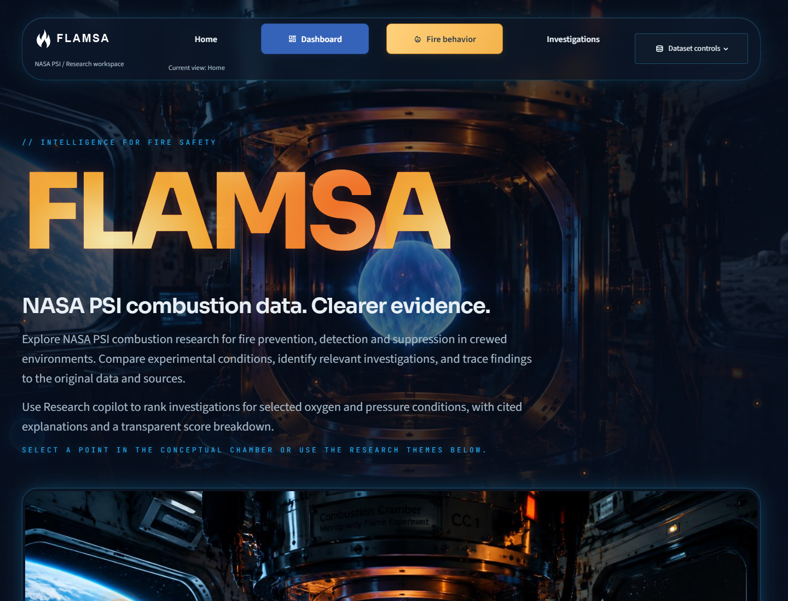
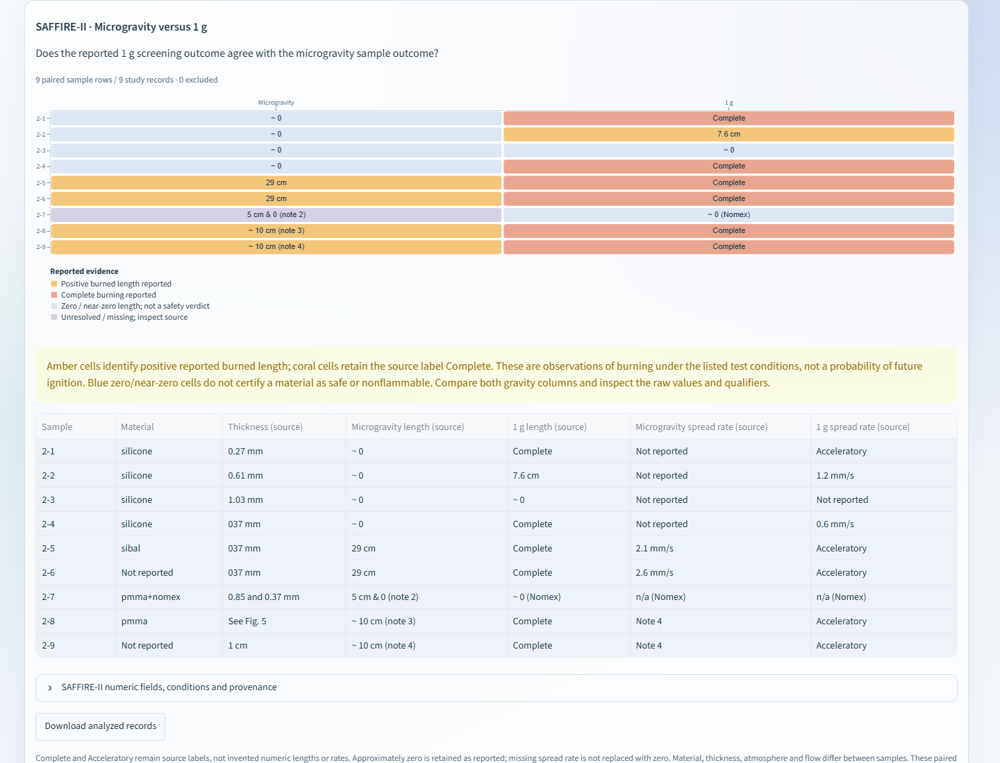
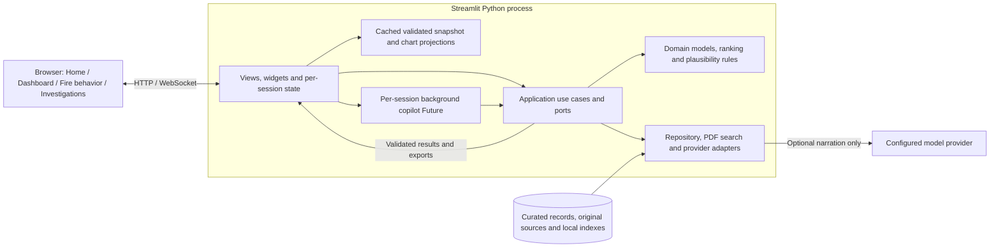
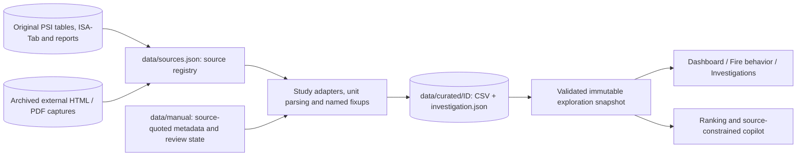
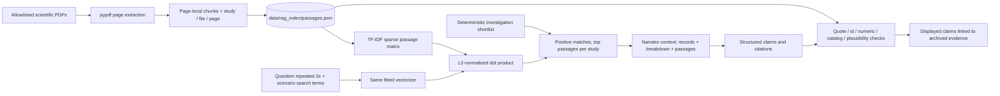
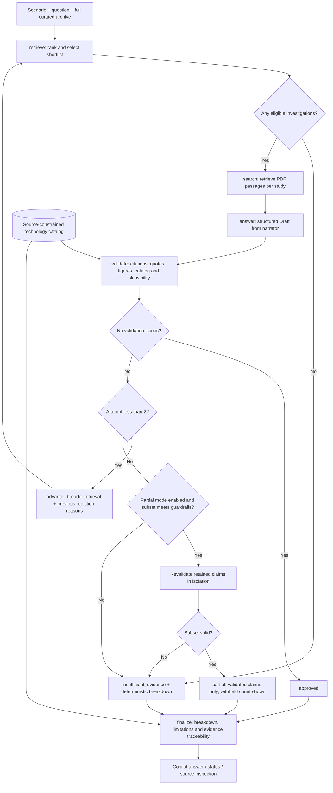
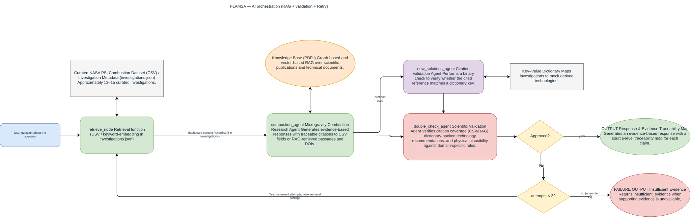

<div align="center">


### NASA PSI combustion research, from reported conditions to cited explanations


**15 investigations / 1,615 curated records / deterministic ranking / source-linked research copilot**

[Public demonstration](https://flamsa-398749245371.us-central1.run.app) | [Run locally](#quick-start) | [Physical consistency rules](#physical-consistency-rules) | [Architecture](#architecture)

</div>



This README describes the workspace reviewed on **2026-11-15**. The current public Cloud Run revision, source commit and hosted checks are recorded in [release metadata](docs/gcp-release.json). Local changes are deployed only after a frozen-source review and hosted verification; live narration also depends on the configured provider's availability.

## Contents

- [The technical challenge](#the-technical-challenge)
- [How FLAMSA addresses it](#how-flamsa-addresses-it)
- [Quick start](#quick-start)
- [The dashboard](#the-dashboard)
- [The data](#the-data)
- [Physical consistency rules](#physical-consistency-rules)
- [The lunar-habitat question](#the-lunar-habitat-question)
- [Explainable ranking](#explainable-ranking)
- [Architecture](#architecture)
- [Vector RAG](#vector-rag)
- [AI orchestration](#ai-orchestration)
- [Verification and reproducibility](#verification-and-reproducibility)
- [Known limits](#known-limits)
- [Repository map](#repository-map)
- [References](#references)

## The technical challenge

The user-supplied NASA Space Apps brief asks for an AI-powered web dashboard that **summarizes, ranks and interprets combustion investigations** for fire prevention, detection and suppression in crewed environments: spacecraft, stations, surface habitats and pressurized rovers. It also invites extracting research data for subsequent modeling and discovering research relevant to future safety equipment. Rockets and propellants are outside this project's scope.

The engineering problem is connecting heterogeneous evidence without erasing its meaning. NASA PSI investigations distribute test conditions and results across CSV/Excel tables, ISA-Tab metadata, PDFs and external hardware documentation. Oxygen can describe the chamber atmosphere or the burner stream; a row can be a test, a daily summary or a planned matrix. Missing measurements, mixed units and categorical outcomes make a pooled chart or an unsupported AI summary misleading.

FLAMSA targets research discovery and interpretation. It does not simulate a habitat fire or predict whether a selected atmosphere will ignite. The brief is mapped to implemented capabilities in [the scope review](docs/navigation-scope-review.md) and [data requirements](docs/specs/streamlit-explorer.md#13-additional-data-requirements-derived-from-the-challenge-brief). Experimental facts still require investigation-specific sources.

## How FLAMSA addresses it

| Challenge need | Implemented response | What makes it checkable |
|---|---|---|
| Summarize heterogeneous studies | Typed Investigation/TestPoint aggregates, canonical units, source-aware charts and study details | Original text, record level, oxygen basis, missing/inferred states and source rows are retained |
| Rank relevant investigations | Five deterministic criteria for a selected oxygen/pressure scenario | Every score has weights, contributions, rationale and supporting record ids |
| Interpret combustion evidence | Research copilot combines structured records, ranking and retrieved PDF passages | Claims, figures and citations are validated before display; failures and limitations remain visible |
| Examine physical behavior | FLEX adjusted trends, BASS-II signed gas changes and paired SAFFIRE-II outcomes | Reproducible coefficients/intervals, local settings, exclusions and downloadable analysis data |
| Reuse data for modeling | Download scoped CSV records, original source documents and Fire behavior JSON/CSV | Dataset revision, units, provenance and analysis identity accompany the relevant exports |
| Explore technology relevance | Source-constrained solution-catalog interface | Catalog is currently empty; no invented technology recommendations are presented |

The workflow is **choose conditions -> inspect experimental coverage -> ask Research copilot -> check the ranking and citations -> open source records or export**. Chart clicks select a scenario; they do not change the scientific measurements.

## Quick start

### Prerequisites

- Git and **Python 3.11+** with `venv`/`pip`; Python 3.12 is the recommended baseline and is used by the container.
- Run commands from the repository root. The original archive, `data/curated`, source registry and RAG corpus must be present; a source-only copy cannot reproduce document downloads or passage retrieval.
- Internet access is needed for the first dependency installation and for live model calls. Once dependencies/data are present, exploration, ranking, statistics and template narration run locally.

### Automatic environment and dependencies

```bash
git clone https://github.com/Huarada/FLAMSA.git
cd FLAMSA
python scripts/run_local.py --offline
```

On Windows, `py -3.12 scripts/run_local.py --offline` is an alternative if `python` is unavailable. On macOS/Linux, use `python3` if needed. Open **http://127.0.0.1:8501** and stop the server with Ctrl+C.

The launcher creates `.venv`, installs the package and its `dashboard`, `rag` and `openai` extras from `pyproject.toml`, and starts Streamlit bound to localhost. It skips pip on later starts when its dependency marker matches; `--reinstall` forces installation. It does not overwrite `.env`, alter raw data or install system packages. `--offline` forces the deterministic template narrator, even if a local model configuration exists; it does not eliminate the first pip download.

Dependencies currently use version ranges rather than a lockfile. A clean Windows/Python 3.12 installation and all four pages were checked with [these resolved versions](docs/readme-clean-install-versions.json); [browser results](docs/readme-clean-install-browser.json) record the page checks. Future installs can resolve different versions.

```bash
# Include pytest/Ruff/mypy; prepare without starting the server
python scripts/run_local.py --dev --install-only

# Start on another port if 8501 is occupied
python scripts/run_local.py --offline --port 8502

# Use the configured provider instead of forcing the offline template
python scripts/run_local.py
```

### Manual setup

```bash
python -m venv .venv
```

Activate on PowerShell with `.\.venv\Scripts\Activate.ps1`, or on macOS/Linux with `source .venv/bin/activate`. Activation is optional when invoking the environment's Python directly.

```bash
python -m pip install -e ".[dashboard,rag,openai,dev]"
python -m streamlit run src/psi_fire/interface/app.py
```

Install all three runtime extras above: the app loads dotenv from the RAG extra, and its copilot factory imports LangGraph. Installing only the old `dashboard,dev` combination is insufficient for the current entry point. There is no npm/Bun dependency or separate React server to start.

### Optional live AI configuration

Copy `.env.example` to `.env` without overwriting an existing configuration. Set:

```dotenv
OPENAI_API_KEY=your-own-provider-key
PSI_LLM_MODEL=openai:gpt-4.1-mini
# Optional: reject the whole draft if any claim fails final validation
PSI_STRICT_ANSWERS=1
```

Remove the last line or set it to `0` for the default guarded partial-answer policy. Leave `PSI_LLM_MODEL` empty to use the template narrator. The template is visibly labeled; it is not a language model. Secrets remain local/environment inputs, never README examples or source-control values. Provider packages other than OpenAI must be installed separately.

Restart the process after changing `.env`, model configuration or domain contracts. Streamlit reruns do not reliably replace an already imported enum/schema or cached pipeline. If dependencies were changed manually, run the launcher with `--reinstall`. Live narration incurs provider latency and charges; the deterministic ranking does not call a provider.

### Public copilot usage limits

The hosted configuration uses `PSI_DAILY_MODEL_LIMIT=4` and `PSI_DAILY_GLOBAL_LIMIT=100`. Each submitted question consumes one allowance, including provider failures; retries within that question do not consume another allowance. Without login, the visitor key is derived from the trusted forwarded network address, so shared IPs share a quota; this is not authenticated per-person enforcement.

Counters are in process memory, shared by sessions, and reset at 00:00 UTC or a process/instance restart, including a new deployment. Cloud Run recycling also resets them. They are demonstration cost guards, not a persistent billing cap. Zero/unset limits disable the corresponding guard locally. A new provider secret version requires a fresh revision to load it; preserve the configured Secret Manager reference and verify that the intended revision receives traffic.

### Optional container

With a working Docker engine:

```bash
docker build -t flamsa .
docker run --rm -p 8501:8080 -e PSI_LLM_MODEL= flamsa
```

The Dockerfile installs Python dependencies and Poppler, copies scientific sources, and runs as a non-root user. For a configured live provider, use `--env-file .env` instead of the empty-model option. The image is large because it retains original source documents. GCP deployment, Secret Manager and session constraints are documented in [the deployment runbook](docs/gcp-deployment-plan.md); local changes are not automatically deployed.

## The dashboard

| Destination | Current role and scope |
|---|---|
| **Home** | FLAMSA fire-gradient wordmark, research entry points, thematic links and live archive counts; motion can be paused |
| **Dashboard** | Research filters, same-record chart eligibility, oxygen/pressure coverage, descriptive comparisons and scenario-linked copilot |
| **Fire behavior** | Full FLEX, BASS-II and SAFFIRE-II studies, with local FLEX fuel/pressure/diameter controls and source-bounded safety-evidence labels |
| **Investigations** | Full-study catalog, metadata status, hardware/sensors, test tables, raw values, provenance, citations and source downloads |

General **Research filters apply only to Dashboard**. Choices within a filter use OR; different filters use AND. Changes apply when **Apply filters** is pressed. Same-record numerical constraints cannot be satisfied by oxygen from one test and pressure from another. A selected study can have matching records but no complete quantity pair for a particular chart; omissions are explained rather than filled.

Leaving Dashboard discards unsubmitted or invalid form drafts while keeping the last applied query. Returning reconstructs the form from that query.

Fire behavior and Investigations preserve the Dashboard query for the return journey but use their own full-study scope. Research copilot ranks the **full curated archive**, not just the visible filtered dots; its evidence may therefore cite investigations outside the Dashboard view. The former Evidence page is folded into Investigations and copilot source inspection, with legacy links redirected.

| Analysis | Displayed evidence | Interpretation boundary |
|---|---|---|
| FLEX | Raw K/O2 points, pressure/diameter-adjusted trends, 95% mean-response intervals and group evidence labels | A point above a line is not an ignition/risk threshold; K describes a burning droplet |
| BASS-II | Initial-minus-final O2 and final-minus-initial CO2, with shapes for joint measured changes/negative differences | Concentration changes do not give CO2 mass, exposure limits or detector performance |
| SAFFIRE-II | Amber positive burned lengths, coral Complete labels and neutral zero/unresolved outcomes, paired by gravity | Positive length does not alone prove sustained propagation; zero does not certify nonflammability |




## The data

| Investigation | PSI | Phase | Fuels (curated names) | Records |
|---|---|---|---|---:|
| **FLEX** | PSI-69 | liquid droplets | heptane, methanol | 274 |
| **FLEX-2** | PSI-68 | liquid droplets | decane, ethanol, heptane, iso-octane, n-octane and blends | 8 (test matrix) |
| **CFI** | PSI-39 | liquid droplets | n-dodecane, n-dodecane + iso-dodecane | 87 |
| **ACME-CFI-G** | PSI-159 | gas, spherical burner | ethane, propane, butane | 333 |
| **ACME-BRE** | PSI-20 | gas | ethylene, methane | 18 (test days) |
| **ACME-E-FIELD** | PSI-22 | gas, electric field | ethylene, methane | 21 (test days) |
| **SPICE** | PSI-107 | gas jet in coflow | ethylene, methane, propane, propylene (pure and N₂-diluted) | 469 |
| **SLICE** | PSI-106 | gas jet | ethane, ethylene, methane | 12 (test days) |
| **BASS** | PSI-26 | solid | PMMA, SIBAL, Nomex, Ultem, waxes | 122 |
| **BASS-II** | PSI-25 | solid | PMMA, SIBAL, Nomex, Japan wax | 129 |
| **SAFFIRE-I / II / III** | PSI-98 / 99 / 100 | solid, large scale | SIBAL, PMMA, silicone, PMMA + Nomex | 2 / 9 / 2 |
| **SAME** | PSI-102 | solid, smoke | Kapton, Teflon, silicone rubber, lampwick, DBP | 20 |
| **SAME-R** | PSI-101 | solid, smoke | Kapton, Teflon, silicone rubber, lampwick, Pyrell | 109 |
| | | | **Total** | **1,615** |

Curation rules:
- Units are part of the column name: `pressure_psi`, `o2_percent`, `flow_speed_cm_s`, length in `mm`, time in `s`. Conversions are named constants, for example 1 mmHg = 0.0193368 psi.
- `<column>_raw` keeps the source string whenever it differs from the normalized value.
- Each row records its source file (resolved through `data/sources.json`), source row, `provenance_status ∈ {verified, inferred, missing}` and a `provenance_note`.
- Each hand-curated claim cites one printed line or one DOCX paragraph and is verified mechanically against the archived file.
- The output is one folder per investigation, `data/curated/<ID>/test_points.csv` plus `investigation.json`. Both load directly into pandas or any other tool.

---

## Physical consistency rules

The relations below have different roles: approximate physical models, deterministic calculations, automated regression checks and documentary context. Tests in [`tests/infrastructure/test_physical_consistency.py`](tests/infrastructure/test_physical_consistency.py) run when pytest is invoked; they are not automatically executed by curation or every dashboard load. Passing these checks can reveal consistency and catch some mapping/unit errors, but does not establish every measurement as correct. [Formula audit and implementation map](docs/formula-audit.md) records which relations the interface actually calculates.

Quotes are copied exactly from the archived file. The numbers in brackets point to the [References](#references).

### R1 · Check the approximate d² model (FLEX)

In the idealized quasi-steady model, the squared droplet diameter decreases at constant rate K. The diameter itself does not decrease linearly:

```math
d(t)^2 \;=\; d_0^{\,2} \;-\; K\,t
\qquad\Longrightarrow\qquad
t_b \;=\; \frac{d_0^{\,2} - d_e^{\,2}}{K}
```

Here $`d_0`$ is the initial diameter, $`d_e`$ the reported diameter at flame extinction, $`K`$ the burning-rate constant in mm²/s, and $`t_b`$ the burn time. A reported physical burnout diameter can be zero; an unreported diameter is never replaced by zero.

FLEX reports $`d_0`$, $`d_e`$, $`K`$ and $`t_b`$ in separate columns, so the law can be tested directly against the table:

```math
\mathrm{median}\!\left(\frac{t_b^{\text{reported}}}{(d_0^{2}-d_e^{2})/K}\right) = 1.0492
\qquad (n = 155,\ \text{IQR } 1.0292\text{–}1.0773)
```

This checkpoint uses only finite reported diameters, K and burn time, with K > 0, burn time > 0 and d0 > 1.1 de. The 10% diameter-change screen is a numerical sensitivity policy, not a physical law. Missing extinction diameters are excluded, never set to zero. This check is executed in tests; the interface displays the physical model, not a newly calculated validation score. Some outliers can be flames that went out just after ignition ($`d_e \approx d_0`$); for those the denominator is close to zero.

> "diameter should decrease linearly with time with Ko being constant"
>
> Liu, Trenou, Rah, Hicks and Avedisian, *Effect of Varying the Initial Diameter of n-Octane and n-Decane Droplets over a Wide Range on the Spherically Symmetric Combustion Process* [1], p. 2. The paper measures n-octane and n-decane on the ISS and takes the law from Turns, *An Introduction to Combustion* [2].

The printed sentence says "diameter", but the displayed equation and normalized axes on that same page use squared diameter. The d² interpretation is the one used here; the source wording is preserved in the quotation.

### R2 · Estimate the oxygen association within comparable groups (FLEX)

Classical droplet theory links $`K`$ to the Spalding transfer number $`B`$, which grows with the ambient oxygen mass fraction $`Y_{O_2,\infty}`$:

```math
K \;=\; \frac{8\,\lambda_g}{\rho_\ell\,c_{p,g}}\,\ln\!\left(1 + B\right),
\qquad
B \;=\; \frac{c_{p,g}\,(T_\infty - T_s) \;+\; Y_{O_2,\infty}\,\Delta h_c/\nu}{h_{fg}}
\qquad\Longrightarrow\qquad
\frac{\partial K}{\partial Y_{O_2,\infty}} > 0
```

Here $`\lambda_g`$ and $`c_{p,g}`$ are the gas thermal conductivity and heat capacity, $`\rho_\ell`$ the liquid density, $`\Delta h_c`$ the positive heat-of-combustion magnitude, $`\nu`$ the stoichiometric O₂/fuel mass ratio and $`h_{fg}`$ the latent heat. $`T_\infty`$ and $`T_s`$ are ambient and droplet-surface temperatures.

This idealized expression holds other properties fixed. Its positive derivative is not a universal prediction across different fuels, pressures, diluents or extinction regimes. With SI inputs it gives K in m²/s (multiply by 10⁶ for mm²/s). The application does not evaluate this transfer-number model: its required thermophysical inputs are not mapped per test.

On the *Fire behavior → FLEX* tab, eligible fuel/diluent-blend groups near 1 atm receive a separate ordinary least-squares fit:

```math
K_i \;=\; \beta_0 \;+\; \beta_{O_2}\,X_{O_2,i} \;+\; \beta_P\,P_i \;+\; \beta_d\,d_{0,i} \;+\; \varepsilon_i,
\qquad
\hat\beta_{O_2} \;\pm\; t_{0.975,\;n-p}\;\mathrm{SE}\!\big(\hat\beta_{O_2}\big)
```

Pressure and initial diameter are included only when they vary within the group. A group is fitted when it has at least 6 tests, 3 distinct O₂ levels, 3 residual degrees of freedom, full design rank and a standardized condition number no higher than 10⁴. Here n counts observations and p counts fitted parameters, including the intercept. The 95% interval assumes independent, homoskedastic, normally distributed errors; it omits calibration and model-form uncertainty. With the current data:

| Stratum (≈ 1 atm) | n | $`\hat\beta_{O_2}`$ (mm²/s per O₂ point) | 95% interval | Tested O₂ |
|---|---:|---:|---|---|
| heptane · N₂ | 32 | **0.0185** | 0.0062 – 0.0307 | 13–30% |
| methanol · N₂ | 41 | **0.0183** | 0.0157 – 0.0209 | 12–30% |

Diluent groups remain separate. Differences between pooled medians would also reflect oxygen, pressure and initial-diameter coverage; those differences alone cannot identify a causal diluent or radiation effect.

> "The ambient oxygen mole fraction influences the burning rate, extinction diameter, flame chem-"
>
> Williams et al., *Science Requirements Document: Fundamental Studies in Droplet Combustion and Flame Extinguishment in Microgravity (FLEX-2)* [3], p. 42. The document does not give the sign of the effect; that comes from the theory above.

### R3 · Extinction diameter scales with initial diameter (FLEX)

```math
d_e \;\approx\; a + b\,d_0 \qquad (\text{conditional radiative-extinction trend})
```

This is a conditional trend for radiative extinction, not an enforced proportionality law or current automated test. A linear relationship need not pass through the origin. Fuel, atmosphere, soot formation and extinction regime matter; a pooled diameter correlation alone does not establish their separate effects.

A droplet that broke apart never reached an extinction diameter, so a `0` recorded for a *disruption* outcome is treated as missing (the raw `0` is kept).

> "Theory1 suggests a linear relationship between extinction diameter, de , and initial droplet diameter, d0"
>
> Hicks, Dietrich, Nayagam and Williams, *Dynamics of Water Absorption and Evaporation During Methanol Droplet Combustion in Microgravity* [4], slide 11. The "1" marks the slide's footnote to Zhang, Card and Williams, *Combustion and Flame* (1996).

### R4 · The stoichiometric mixture fraction follows from the composition (ACME-CFI-G)

For a fuel stream (mass fraction $`Y_F`$, balance N₂) facing an oxidizer stream (mass fraction $`Y_{O_2}`$, balance N₂):

```math
Z_{st} \;=\; \left(1 + \frac{s\,Y_F}{Y_{O_2}}\right)^{-1},
\qquad
s \;=\; \frac{\nu_{O_2}\,W_{O_2}}{W_F}
\quad
\left(\begin{array}{l}
\mathrm{C_2H_6}:\ s = 3.72\\
\mathrm{C_3H_8}:\ s = 3.63\\
\mathrm{C_4H_{10}}:\ s = 3.58
\end{array}\right),
\qquad
Y_k \;=\; \frac{X_k\,W_k}{X_k\,W_k + (1 - X_k)\,W_{N_2}}
```

We recomputed $`Z_{st}`$ from the reported O₂ and fuel mole fractions for all 331 flames, normal and inverse. The largest difference from the reported value is

```math
\max_i \left| Z_{st,i}^{\text{recomputed}} - Z_{st,i}^{\text{reported}} \right| \;\approx\; 4.081\times10^{-5}
```

That agreement would not survive a swapped or mis-converted oxygen or fuel column.

> "where Zst and Tad are respectively the stochiometric mixture fraction and adiabatic flame"
>
> Stocker, Sunderland, Axelbaum and Williams, *ACME/CFI-G Final Report: Advanced Combustion via Microgravity Experiments, Cool Flames Investigation with Gases* [5], p. 29.

### R5 · Check oxygen continuity within a chamber fill (ACME-CFI-G)

Oxygen consumption reduces the amount of O₂ in a sealed chamber. Mole fractions also depend on total gas moles, combustion products and gas exchange, so the first inequality below is a checked observation in this dataset, rather than a universal consequence of mass balance. The second describes continuity within an unchanged chamber fill:

```math
X_{O_2}^{\,\text{after}}(n) \;\le\; X_{O_2}^{\,\text{before}}(n),
\qquad
X_{O_2}^{\,\text{before}}(n+1) \;=\; X_{O_2}^{\,\text{after}}(n)
\quad\text{within one chamber fill}
```

The first relation holds for all 179 normal flames. The second holds to $`10^{-6}`$ in 156 of 168 consecutive same-day pairs; the other 12 differ, consistent with atmosphere resets; their individual cause is not established by the equality check alone. Within a test day, then, O₂ drifts down from test to test and should not be read as a freely chosen condition.

> "recirculation during CFI-G test operations was only conducted prior to venting: (1) at the end of a test day and/or (2) between atmospheres"
>
> Stocker et al., *ACME/CFI-G Final Report* [5], p. 19.

### R6 · Compare gas changes with complete-combustion stoichiometry (BASS-II)

PMMA burns as

```math
\mathrm{C_5H_8O_2} \;+\; 6\,\mathrm{O_2} \;\longrightarrow\; 5\,\mathrm{CO_2} \;+\; 4\,\mathrm{H_2O}
\qquad\Longrightarrow\qquad
\frac{\Delta n_{CO_2,\,produced}}{\Delta n_{O_2,\,consumed}} \;=\; \frac{5}{6} \;\approx\; 0.833
```

The 5/6 ratio applies to molar amounts for complete PMMA combustion. It is not automatically the ratio of measured concentration differences: that comparison also needs a common gas basis, approximately constant total gas amount and accounting for water condensation, incomplete combustion and measurement error.

For 24 complete PMMA reading pairs with an O₂ decrease strictly above 0.2 percentage points (allowing numerical roundoff), an exploratory least-squares slope through the origin of CO₂ concentration increase against O₂ concentration decrease is

```math
\widehat{\left(\frac{\Delta X_{CO_2}}{\Delta X_{O_2}}\right)}_{\mathrm{PMMA}} \;=\; 0.822
\qquad \text{(exploratory concentration fit, not a molar-balance validation)}
```

The production BASS-II chart shows signed same-test differences; it has no fitted stoichiometric line. The exploratory coefficient above has no reported uncertainty and is not an automated test or a safety threshold. In the curated pairs, CO₂ never falls by more than the sensor's reported 0.1 percentage-point resolution.

The size of the glovebox limits how much O₂ a burn can remove:

```math
m_{O_2} \;\approx\; \frac{\Delta X_{O_2,pp}}{100}\,\frac{P\,V}{R\,T}\,W_{O_2}
\;\approx\; 33\ \text{g for }\Delta X_{O_2} = 10\ \text{points in } V = 250\ \text{L}
\;\;\Rightarrow\;\; \approx 17\ \text{g of PMMA}
```

This illustrative estimate assumes P = 101325 Pa, T = 298.15 K, V = 0.250 m³, R = 8.314462618 J/(mol K), W(O₂) = 32 g/mol and approximately constant total gas amount. It gives 32.7 g O₂, equivalent to about 17 g PMMA under complete combustion. It is not a measured per-test mass or an acceptance limit.

Five final-O₂ readings (1.6, 0.6, 0.9, 39.1 and 40.4%) were flagged as suspect in the curation review and are missing with raw values retained (ADR-0080). The illustrative PMMA calculation does not establish the actual fuel mass or error mechanism for each of these mixed-material tests. Negative CO readings are also set aside; a sensor zero offset is a plausible interpretation, not a separately established cause for every reading.

> "The O2 decreased during each burn and the CO and CO2 increased accordingly."
>
> Olson, Ferkul, Bhattacharjee, Miller, Fernandez-Pello, Link, T'ien et al., *Burning and Suppression of Solids-II (BASS-II) Summary Report* [6], p. 14. The 250 L work volume is given on p. 87.

### R7 · Spread rate equals burned length over burn time (SAFFIRE-II)

```math
v_f \;=\; \frac{L_b}{t_b}
```

The source lists $`L_b`$, $`t_b`$ and $`v_f`$ in separate columns. $`290\,\text{mm}/145\,\text{s} = 0.20`$ cm/s against 0.21 reported, and $`290/115 = 0.25`$ cm/s against 0.26.

The SAFFIRE-II tab also shows the result the experiment was built to test. For silicone samples 2-1 and 2-4, the source reports Complete in 1 g and approximately zero flight burned length. Sample 2-2 instead reports 7.6 cm in 1 g and sample 2-3 approximately zero in both conditions. The matrix preserves these distinctions. The length/time relation is an average-speed consistency check (with mm converted to cm), not a law relating ground and flight outcomes or an imputed rate for Acceleratory/missing cells.

### R8 · Mass flow equals volume flow times gas density (SPICE)

```math
\dot m \;=\; \dot V\,\rho,
\qquad
\rho \;=\; \frac{P\,\overline{W}}{R\,T},
\qquad
\overline{W}_{\,75\%\,\mathrm{C_3H_6}/\mathrm{N_2}} \;=\; 0.75\,(42.08) + 0.25\,(28.01) \;=\; 38.56\ \mathrm{g\,mol^{-1}}
```

| Gas (at 101.325 kPa) | $`\rho`$ at 294 K (kg/m³) | $`\rho`$ at 300 K (kg/m³) | Implied by the source table before fixups (kg/m³) |
|---|---:|---:|---:|
| propylene | 1.743 | 1.709 | **1.709** |
| 50% propylene / N₂ | 1.452 | 1.424 | **1.423** |
| 75% propylene / N₂ | 1.598 | 1.567 | **1.566** (96 rows), 0.651 (36 rows) |
| methane | 0.665 | 0.652 | **0.651** |

For mass flow in mg/s and volume flow in sccm, the numerical value $`\rho = 60\,\dot m / \dot V`$ is in kg/m³ at the volumetric flow's reference state. The retained pairs imply nearly constant density for each gas, close to the ideal-gas value at 101.325 kPa and 300 K. The pressure and temperature used with sccm must match its stated reference conditions; this agreement does not establish the instrument's actual reference temperature or independently prove calibration.

36 rows labeled *75 % Propylene* give methane's density instead, which puts their mass flows about 2.4 times too low. Both mass-flow columns in those rows are treated as missing, with the raw values and a note kept; the volume flow is unchanged. We did not compute a replacement mass flow, since that would put a calculation where a measurement was.

> "75% propylene mixed with 25% nitrogen in moles, and 50% propylene mixed with 50% nitrogen in moles"
>
> Urban, Sunderland and Yuan, *Smoke Point in Co-flow Experiment (SPICE): Laminar Smoke Point Properties of Non-buoyant Round-Jet Diffusion Flames*, Final Report [7], p. 9.

### How violations are handled

| Situation | Action | Example |
|---|---|---|
| Source value is flagged as physically inconsistent in a documented review | Named adapter fixup sets it to missing, raw kept, row `inferred` with the reason | BASS-II final O₂ of 40.4% |
| Value contradicts another cell, and nothing settles which one is right | Value kept, conflict note added, row stays `verified` | ACME-CFI-G 21106 F4: "no hot ignition" with a 22 s burn |
| Composition does not close | Kept, with a note; never normalized | CFI r13–r16: O₂ + N₂ + He = 0.97 |
| Plausible fix, but the sources disagree | Kept missing until an archived source settles it | SAFFIRE-II thickness `037 mm` (NASA sources give 0.33, 0.36 or 0.37 mm) |

The full review is in [`docs/DATA_QUALITY_REVIEW.md`](docs/DATA_QUALITY_REVIEW.md), and the decisions are in [`docs/ADR.md`](docs/ADR.md) (ADR-0067 and ADR-0080).

---

## The lunar-habitat question

> *"Which microgravity evidence is relevant to a lunar base at ≥ 30% O₂ and ≤ 10.2 psi?"*

Before anything else, the data has to say how much of it applies. The *Dashboard* opens on a coverage map with tests grouped into count bubbles in 1-percentage-point O2 and 0.5-psi bins, separately by investigation and oxygen basis. The default shows chamber oxygen and a 0-20 psi habitat zoom; controls reveal burner-stream oxygen and the full pressure range. Bubble sizes/counts describe test density, not risk. The lunar scenario is a reference box, and Earth cabin air is a reference marker. Counts below describe all eligible records, including those hidden by the default presentation controls.

```math
\#\big\{\,\text{tests} : X_{O_2} \ge 30\%\ \wedge\ P \le 10.2\ \text{psi}\,\big\}
\;=\;
\underbrace{20}_{\substack{\text{ACME-CFI-G normal flames}\\ \text{O}_2\text{ in the chamber}}}
\;+\;
\underbrace{28}_{\substack{\text{ACME-CFI-G inverse flames}\\ \text{O}_2\text{ in the burner stream}}}
```

| Investigation | Tests with O₂ and pressure | In the scenario | Tested pressure | Tested O₂ |
|---|---:|---:|---|---|
| ACME-CFI-G | 333 | 20 + 28 | 7.18–48.0 psi | 12–85% |
| FLEX | 273 | 0 (17 at 10.33–10.50 psi) | 10.2–44.9 psi | 12–34% |
| CFI | 87 | 0 | 7.35–73.5 psi | 17–21% |

- The 20 scenario tests are gas flames (14 butane, 6 ethane), all at 7.35 psi with 33–39% O₂ in the chamber atmosphere. In the 28 inverse flames, the measured O₂ belongs to the gas leaving the burner, not to the atmosphere a crew would breathe.
- Of the 1,556 individual tests in the archive, 693 report both O₂ and pressure. The other twelve investigations report one of the two, or neither, as individual tests (FLEX-2 lists only a planned test matrix), so they cannot be placed on the map.
- The near-1 atm slopes from R2 are not extended to 10.2 psi.
- The PSI has no partial-gravity data, so microgravity and 1 g comparisons do not by themselves establish upper/lower bounds or a valid interpolation for lunar gravity.

---

## Explainable ranking

The score orders **research relevance**, not fire risk, safety or probability of ignition:

```math
S_j = \sum_{c=1}^{5} w_c v_{j,c}, \qquad 0 \leq v_{j,c} \leq 1, \qquad \sum_c w_c=1
```

| Criterion | Weight | Current calculation |
|---|---:|---|
| Ambient oxygen proximity | 0.30 | Nearest reported compatible interval; burner-stream oxygen is excluded |
| Pressure proximity | 0.20 | Nearest reported pressure interval |
| Fire-safety pillar overlap | 0.15 | Fraction of requested pillars present in curated metadata |
| Fuel-phase match | 0.15 | Match against requested fuel phases; the habitat default favors solids |
| Data richness | 0.20 | Saturating individual-test count, multiplied by the fraction with verified lineage |

For oxygen/pressure, proximity is `max(0, 1 - distance / scale)`, with distance zero inside a reported interval; scales are 20 oxygen percentage points and 14.7 psi. Missing conditions receive zero proximity credit. Scores use fixed rounding and ties are broken by investigation id. The two proximity criteria may draw evidence from different records: a high relevance score does not prove that one test simultaneously covered the scenario. Use the Dashboard map for joint oxygen/pressure coverage.

Weights and evidence limits live in [`domain/ranking.py`](src/psi_fire/domain/ranking.py), with deterministic regression tests in [`test_ranking.py`](tests/domain/test_ranking.py). Metadata lineage marked verified is not the same as formal human review or independently verified scientific correctness. The LLM cannot change these scores.

## Architecture

### Frontend, Python application and external services

Streamlit serves the browser UI and executes Python application logic in the **same process**. There is no separately deployed REST backend, React frontend, vector database or database server in the current app. The diagram shows runtime data flow; the layer table below describes code dependencies.



| Layer | Responsibilities | Dependency boundary |
|---|---|---|
| `domain` | Investigation/TestPoint/Quantity, provenance, scenario, deterministic relevance and physical plausibility | No I/O, pandas, Streamlit or LangGraph; Pydantic is allowed |
| `application` | Explore/build analyses, statistics, source access, answering steps, validation, ports | Uses domain; no UI/framework imports |
| `infrastructure` | Registry/ingestion, filesystem repository, PDF extraction/TF-IDF, LangChain narrator, LangGraph wiring | Implements application ports; depends inward |
| `interface` | Streamlit composition root, views, session state, exports and background-job presentation | Calls application contracts and wires adapters |

The UI streams lightweight content before deferred copilot setup. Snapshot and chart caches avoid repeated data loading; a session-owned Future retains a submitted question across reruns. Workers return results instead of writing Streamlit state. These jobs are not durable across a process restart or Cloud Run instance replacement.

### Scientific data pipeline



External source capture is a separate curation workflow, not live web browsing by the copilot. It retains HTML/PDF, derived Markdown where applicable, capture time and artifact hashes. A URL association alone does not verify hardware or sensors. See [external-source policy](docs/external-sources.md).

## Vector RAG

The implemented retriever uses **sparse lexical TF-IDF vectors**, English stop words, word unigrams/bigrams and sublinear term frequency. It does not use dense neural embeddings, an embedding API, ANN infrastructure or Graph RAG. The LangGraph orchestration graph is a workflow graph, not a knowledge graph.

[`PdfPassageSearch`](src/psi_fire/infrastructure/passage_index.py) reads the explicit scientific-PDF allowlist in `data/rag_corpus.json`. `pypdf` extracts pages; line-based chunks target 1,200 characters with an 80-character minimum, retain the page locator, and never cross pages. A single unusually long line may exceed that target. The derived JSON cache stores passage text and locators; the vectorizer/matrix are built lazily in memory.



For L2-normalized vectors, the passage/query dot product is cosine similarity:

```math
\mathrm{similarity}(q,p)=\frac{q\cdot p}{\lVert q\rVert_2\lVert p\rVert_2}
```

Retrieval scores select passages **within the deterministically ranked studies**; they do not set investigation relevance scores. Matches must be positive, with deterministic tie-breaking. See [scikit-learn's TF-IDF reference](https://scikit-learn.org/stable/modules/generated/sklearn.feature_extraction.text.TfidfVectorizer.html).

To explicitly rebuild the derived cache after a reviewed corpus update:

```bash
# Inside the activated environment, after editable installation
python scripts/build_rag_index.py
```

The corpus includes only allowlisted `knowledgeBase/` scientific PDFs. Archived external HTML and every raw spreadsheet are not automatically embedded/indexed. PDF text extraction and a mechanically matching quotation do not establish that a claim's scientific interpretation is correct. Changing retrieval technology is possible behind `PassageSearch`, but no dense-vector/graph implementation is claimed here.

## AI orchestration

### Implemented LangGraph state machine

Only the narrator can call a language model. Retrieval, ranking, solution lookup, physical/numeric checks and routing are deterministic Python functions behind application ports. The same `AnsweringSteps` run in a plain-Python reference loop and in the LangGraph adapter.



| Policy | First attempt | Second and final attempt |
|---|---:|---:|
| Maximum shortlisted studies | 5 | 6 |
| Minimum relevance score | 0.25 | 0.10 |
| Retrieved passages per study | 2 | 4 |

These settings broaden evidence retrieval, not experimental coverage or physical limits. Empty shortlists skip narration. The question and scenario are captured at submission; editing draft inputs during a request does not silently alter the in-flight question.

Citations have four supported kinds: **record**, **metadata**, **passage** and **breakdown**. Record citations resolve to a test/row; passage citations require a retrieved file/page/quote; breakdown citations identify an application-computed score, rank or criterion and do not pretend to come from a PDF. Metadata review status remains explicit.

After validation and any retry:

- **Approved:** all displayed claims pass the implemented checks.
- **Partial:** at least two claims and at least 50% of the final draft pass, no whole-draft issue prevents extraction, and the retained subset revalidates independently. Failed text is withheld; the UI shows the count and warns about incompleteness.
- **Insufficient evidence:** the generated explanation is withheld and the deterministic breakdown/limitations remain available.

`PSI_STRICT_ANSWERS=1` disables partial answers. Validated does not mean independently replicated science: quote matching and numeric rules have defined tolerances, and partial output can omit context. The catalog in `data/solutions_catalog.json` currently has no entries. An illustrative entry, if added later, is not scientific evidence.

### Supplied conceptual orchestration diagram



[Open SVG](docs/diagrams/ai-orchestration-concept.svg) | [Editable draw.io file](docs/diagrams/ai-orchestration-concept.drawio) | [Source provenance and differences](docs/diagrams/ai-orchestration-concept.provenance.json)

This is the team's supplied design, translated into English while retaining its layout and conceptual nodes. It is **not the deployed runtime topology**. Its graph/vector RAG box describes options, its agent names describe responsibilities, and its mock technology dictionary is conceptual. The implementation above uses TF-IDF, one optional LLM narrator, deterministic validation/catalog lookup, exactly 15 loaded investigations and the newer guarded partial-answer path. This distinction prevents the design artifact from claiming unimplemented Graph RAG or invented technology evidence.

## Verification and reproducibility

Use the activated development environment, or prefix commands with `.venv/Scripts/python.exe` on Windows / `.venv/bin/python` on macOS/Linux:

```bash
python -m ruff check .
python -m mypy src/psi_fire/domain
python -m pytest -q
```

For restricted temporary directories, choose a new workspace-local path, for example `python -m pytest -q -p no:cacheprovider --basetemp .test-tmp/pytest-readme-check`. Use a fresh path for each run. PDF visual-line evidence checks additionally require **Poppler's `pdftotext` on PATH**; the Dockerfile installs Poppler automatically, while the Python launcher only installs Python dependencies. Tests that skip for a missing system tool are not completed scientific checks.

| Business rule | Evidence / validation |
|---|---|
| Same scenario produces the same ordered relevance scores | `tests/domain/test_ranking.py` |
| Filters honor OR/AND, same-record conditions and missing-value policy | `tests/application/test_explorer.py`, `tests/interface/test_filter_chart_regressions.py` |
| Curation preserves values, fixups, units and provenance | `tests/infrastructure/test_curation.py`, `tests/infrastructure/test_standardization.py` |
| Selected physical relations are consistent within documented assumptions | `tests/infrastructure/test_physical_consistency.py` and [formula audit](docs/formula-audit.md) |
| Adjusted slopes recover a known effect; unavailable/collinear fits fail visibly | `tests/application/test_fire_behavior.py` |
| Evidence labels never convert zero/missing data into a safety verdict | `tests/application/test_behavior_signals.py`, `tests/infrastructure/test_fire_behavior_data.py` |
| Answering retries/partial handling and citation traces obey contracts | `tests/application/test_answering_contract.py`, `tests/application/test_citation_traceability.py` |
| UI navigation, source access and local analysis controls remain usable | `tests/interface/` and recorded browser checks in `docs/` |

Tests are checks of implementation and selected data relationships, not experimental proof of a universal law. Historical evaluation counts belong to their recorded code/model revision: [RAG stress evidence](docs/rag-stress-report-live7.md), [failure attribution](docs/rag-failure-attribution-live7.md) and [partial-answer trade-offs](docs/h1-partial-answers-tradeoffs.md). Do not interpret replay results or the first hosted smoke tests as a current guaranteed answer-approval rate.

Optional rebuild of curated data from registered sources, after reviewing intended curation changes:

```bash
python -m psi_fire.interface.curate_cli
```

The committed curated files are sufficient to start. Curation and pytest are explicit workflows; physical checks do not silently run on every dashboard load. Fire behavior's exported JSON includes the dataset revision, analysis identity, settings, exclusions, source columns, model coefficients/intervals and deterministic evidence labels.

## Known limits

- This curated collection contains no direct partial-gravity combustion measurements. E-FIELD emulation is not a lunar experiment; microgravity and 1 g alone do not validate a lunar interpolation or universal bounds.
- Regression slopes are conditional associations in observed groups/ranges. Neither a positive trend, a point above a fit nor a zero burned length defines habitat risk or certifies safety.
- Metadata are still marked draft until a real reviewer records approval. Their review count was removed from Home, not changed to reviewed. Hardware/source associations and automated quote checks are not formal human review.
- Research relevance can be supported by different records for different criteria. Sparse coverage, missing conditions, planned matrices and daily summaries remain distinct from complete individual tests.
- TF-IDF is lexical retrieval; extraction quality and vocabulary mismatch can limit evidence recall. There is no dense embedding index or Graph RAG, and no automatic indexing of arbitrary external pages.
- A successful validation pass checks the declared rules; it does not guarantee completeness, causal validity, absence of all hallucinations or calibrated sensor performance. Partial answers can lose context and are explicitly labeled.
- Technology recommendations require catalog entries with provenance; the current catalog is empty. The one-click combined CSV/JSON/schema/data-card bundle remains future work, although scoped record/source and Fire behavior exports are implemented.
- Source defects that cannot be resolved remain documented: [quality review](docs/DATA_QUALITY_REVIEW.md). No substitute measurement is invented.
- Cloud deployments use independent image snapshots. Cold starts, WebSocket reconnections and non-durable session jobs affect availability; no production load/SLA claim is made.

## Repository map

```text
knowledgeBase/                   immutable original NASA PSI archive
data/                            (directory names below are relative to data/)
  sources.json                   source registry and external associations
  manual/                        source-quoted metadata + review state
  external/                      versioned HTML/PDF captures and hashes
  curated/<ID>/                  test_points.csv + investigation.json
  rag_corpus.json                allowlist for scientific PDF retrieval
  rag_index/passages.json        generated page-local passage cache
  solutions_catalog.json         source-constrained technology dictionary
src/psi_fire/
  domain/                        entities, units, deterministic ranking and plausibility
  application/                   use cases, ports, statistics, validation and answering steps
  infrastructure/                ingestion/repository, TF-IDF, LangChain and LangGraph adapters
  interface/                     Streamlit app.py, views, sessions and copilot jobs
scripts/                         local launcher, index rebuild and audit/evaluation tools
deploy/                          container startup
Dockerfile                       non-root Streamlit image including scientific sources
pyproject.toml                   package dependencies and optional extras
tests/                           domain / application / infrastructure / interface checks
docs/
  specs/                         behavior and orchestration contracts
  diagrams/                      supplied conceptual design, editable source and provenance
  ADR.md                         append-only decisions, defects and trade-offs
```

[Dashboard guide](docs/dashboard.md) | [Fire behavior methods](docs/fire-behavior.md) | [Formula audit](docs/formula-audit.md) | [AI contracts](docs/specs/ai-orchestration-contracts.md) | [Deployment](docs/gcp-deployment-plan.md) | [Decisions](docs/ADR.md)

---

## References

The cited reports are archived in `knowledgeBase/`; reference [2] is a textbook cited by a report and is not archived here. Source passages support their specific statements, not every stronger inference in a section.

1. Y. C. Liu, K. N. Trenou, J. Rah, M. C. Hicks, C. T. Avedisian. *Effect of Varying the Initial Diameter of n-Octane and n-Decane Droplets over a Wide Range on the Spherically Symmetric Combustion Process: International Space Station and Ground-based Experiments.* 8th U.S. National Combustion Meeting, paper 070HE-0310, University of Utah, May 2013. `knowledgeBase/suppression/FLEX/2G11-070HE-0310.pdf`
2. S. R. Turns. *An Introduction to Combustion: Concepts and Applications*, 2nd ed. McGraw-Hill, 2000, p. 376. Cited by [1]; not archived here.
3. F. A. Williams (research team lead), D. L. Dietrich, M. C. Hicks, V. Nayagam et al. *Science Requirements Document: Fundamental Studies in Droplet Combustion and Flame Extinguishment in Microgravity (FLEX-2).* NASA. `knowledgeBase/suppression/FLEX2/FLEX-2 SRD Final.pdf`
4. M. C. Hicks, D. L. Dietrich, V. Nayagam, F. A. Williams. *Dynamics of Water Absorption and Evaporation During Methanol Droplet Combustion in Microgravity.* 28th Annual Meeting of the American Society for Space and Gravitational Research (as printed on the cover), Nov.–Dec. 2012. `knowledgeBase/suppression/FLEX/20130010979.pdf`
5. D. P. Stocker, P. B. Sunderland, R. L. Axelbaum, F. A. Williams. *ACME/CFI-G Final Report: Advanced Combustion via Microgravity Experiments (ACME), Cool Flames Investigation with Gases (CFI-G).* NASA Glenn Research Center, 21 November 2022. `knowledgeBase/ACME/CFI-G/PSI-159_Reports_FinalRpt_ACME.CFI-G.pdf`
6. S. L. Olson, P. V. Ferkul, S. Bhattacharjee, F. J. Miller, C. Fernandez-Pello, S. Link, J. S. T'ien, I. Wichman et al. *Burning and Suppression of Solids-II (BASS-II) Summary Report.* NASA/TM-20210011385. `knowledgeBase/Flammable/BASS2/BASS-II Summary Report.pdf`
7. D. L. Urban, P. B. Sunderland, Z.-G. Yuan. *Smoke Point in Co-flow Experiment (SPICE): Laminar Smoke Point Properties of Non-buoyant Round-Jet Diffusion Flames.* Final Report, 2 December 2011. `knowledgeBase/MSG (SolidAndGas)/SPICE/SPICE Final Report 12_2_2012.pdf`

---

<div align="center">
<sub>Built for the NASA Space Apps Challenge. Experimental data: NASA Physical Sciences Informatics (PSI). FLAMSA adds curation, verification and visualization, and makes no fire-safety certification.</sub>
</div>
