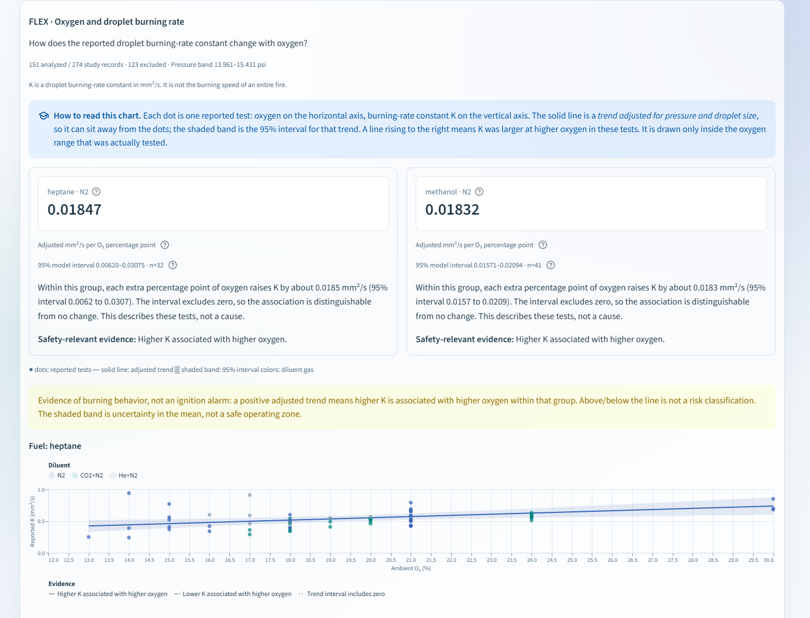
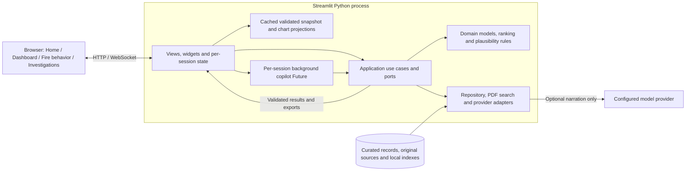
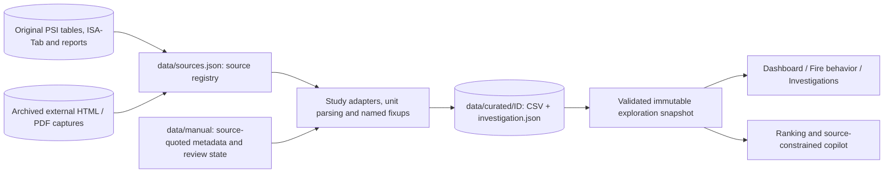
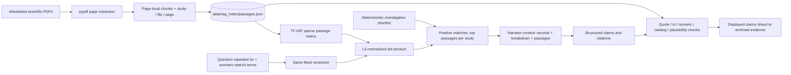
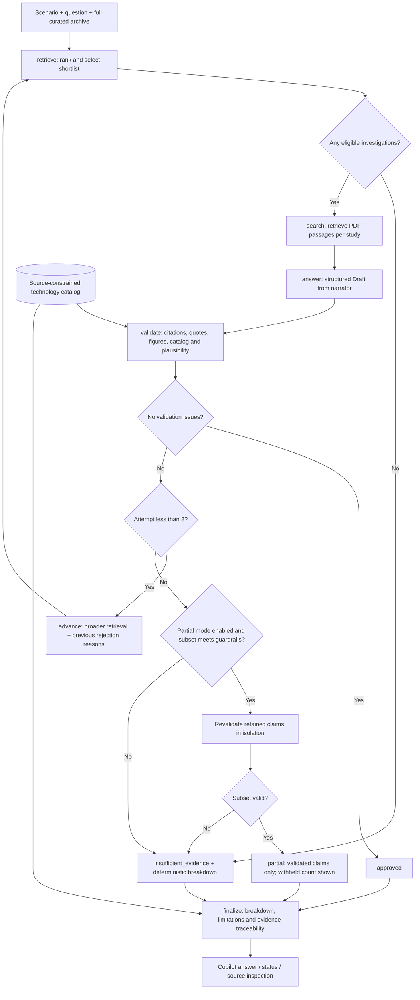

<div align="center">


### NASA PSI combustion research, from reported conditions to cited explanations


**15 investigations / 1,132 NASA files (864 MiB) / 1,615 curated records / source-linked research copilot**

[Live demo](https://flamsa-398749245371.us-central1.run.app) | [Run locally](#3-run-it-locally) | [NASA data](#4-nasa-data-and-how-we-use-it) | [Physics](#5-physics-and-business-rules) | [Architecture](#6-architecture) | [Decisions (ADR)](docs/ADR.md)

</div>


## Contents

1. [The problem](#1-the-problem)
2. [How FLAMSA solves it](#2-how-flamsa-solves-it)
3. [Run it locally](#3-run-it-locally)
4. [NASA data and how we use it](#4-nasa-data-and-how-we-use-it)
5. [Physics and business rules](#5-physics-and-business-rules)
6. [Architecture](#6-architecture)
7. [Useful links](#7-useful-links)

## 1. The problem

NASA Space Apps 2026, **Flame in Freefall**: fire safety in crewed habitats (spacecraft, stations, lunar or Martian bases, pressurized rovers) rests on decades of microgravity combustion experiments stored in NASA's [Physical Sciences Informatics (PSI)](https://psi.nasa.gov) archive. As the challenge itself puts it, that evidence is *"hard to find, harder to compare, and harder yet to interpret"*.

- **Volume and heterogeneity.** A single study mixes CSV and Excel tables, ISA-Tab metadata, reports of 100+ pages, slide decks, engineering drawings and video. For the 15 combustion investigations used here that is 1,132 files and 864 MiB.
- **Traps for a naive reading.** Oxygen can describe the chamber atmosphere or the gas leaving a burner; a row can be one test, a daily summary or a planned matrix; units hide in headers or in values; some measurements are missing. A pooled chart or an unsourced AI summary would mislead.
- **Who feels it.** The audience named by the challenge: professors, graduate and undergraduate students, aerospace researchers and aerospace engineers. In the US alone the BLS counts about 68,700 aerospace engineers (2025), projected to reach 74,400 by 2035. A second audience is engineers at commercial crewed-vehicle companies who assess material flammability under NASA-STD-6001.

Rockets and propellants are out of scope. FLAMSA supports research and learning; it does not simulate a habitat fire, predict ignition or certify safety.

## 2. How FLAMSA solves it

**Choose conditions → see what NASA tested → ask the copilot → check every citation → open the original document.**

| Need | What FLAMSA does | Why it can be trusted |
|---|---|---|
| Find the right experiments | A deterministic ranking scores all 15 investigations for the user's oxygen and pressure | Every score shows its criteria, weights, contributions and the records behind them |
| Compare heterogeneous studies | Curated records in canonical units on one coverage map, with study details | Raw values, record level, oxygen basis and source rows are kept next to every number |
| Interpret the evidence | A research copilot explains the ranking with records, curated metadata and report passages | Each claim is validated before display; unverified claims are withheld and the limitations are always shown |
| Understand the physics | Fire behavior pages: FLEX burning rate, BASS-II gas changes, SAFFIRE-II ground vs. flight | Fitted trends with 95% intervals, source rows, exclusions and downloadable analysis data |
| Reuse the data | CSV export of the filtered records, Fire behavior JSON/CSV, original document downloads | Exports carry units, provenance and the dataset revision |

| Page | Purpose |
|---|---|
| **Home** | Entry points into prevention, detection and suppression research, with live archive counts |
| **Dashboard** | Research filters, the oxygen/pressure coverage map (click a point to set the copilot scenario) and the copilot |
| **Fire behavior** | FLEX, BASS-II and SAFFIRE-II analyses with plain-language reading guides |
| **Investigations** | Each study's objective, hardware, sensors, test table, raw values, citations and source downloads |

**The copilot never invents evidence.** The ranking is computed by the application, not the model. Every claim must cite a record, curated metadata, a retrieved PDF passage or the computed ranking, and numbers and quotes are checked against those sources. A claim that fails is withheld: the answer is shown as **validated**, **partial** (the count of withheld claims is displayed) or **insufficient evidence** (the ranking only). Each citation has a **View source** action that opens the archived NASA document. Technology recommendations are not made, because the archive does not evaluate safety technologies and says so.



## 3. Run it locally

**Requirements:** Git, **Python 3.11+** (3.12 recommended) with `venv` and `pip`, about 2.5 GB of disk (the 864 MiB NASA archive is part of the repository, plus git history and the virtual environment) and internet for the first dependency install. Optional: an OpenAI API key for live narration, Docker, and Poppler's `pdftotext` for PDF line checks in the tests.

```bash
git clone https://github.com/Huarada/FLAMSA.git
cd FLAMSA
python scripts/run_local.py --offline
```

Open **http://127.0.0.1:8501**. The launcher creates `.venv`, installs the package with the `dashboard`, `rag` and `openai` extras from `pyproject.toml` and starts Streamlit; later starts skip the install. `--offline` uses the deterministic template narrator, so no API key or provider cost is involved. On Windows use `py -3.12 scripts/run_local.py --offline` if `python` is not on PATH.

```bash
python scripts/run_local.py --dev --install-only   # add pytest, Ruff and mypy without starting the server
python scripts/run_local.py --offline --port 8502  # another port
python scripts/run_local.py                        # use the model configured in .env
```

<details>
<summary><strong>Manual install, live model, usage limits and Docker</strong></summary>

**Manual install**

```bash
python -m venv .venv
# PowerShell: .\.venv\Scripts\Activate.ps1    macOS/Linux: source .venv/bin/activate
python -m pip install -e ".[dashboard,rag,openai,dev]"
python -m streamlit run src/psi_fire/interface/app.py
```

**Live language model.** Copy `.env.example` to `.env` (git-ignored) and set your own key:

```dotenv
OPENAI_API_KEY=your-own-provider-key
PSI_LLM_MODEL=openai:gpt-4.1-mini
PSI_STRICT_ANSWERS=0         # 1 = reject the whole answer if any claim fails
PSI_DAILY_MODEL_LIMIT=0      # questions per visitor per UTC day, 0 = unlimited
PSI_DAILY_GLOBAL_LIMIT=0     # questions per UTC day for all visitors, 0 = no ceiling
```

Leave `PSI_LLM_MODEL` empty to use the template narrator. Restart the app after editing `.env`. The public deployment uses 4 questions per visitor and 100 in total per day; counters live in memory and reset at 00:00 UTC and on each new release.

**Docker**

```bash
docker build -t flamsa .
docker run --rm -p 8501:8080 -e PSI_LLM_MODEL= flamsa     # or --env-file .env for a live model
```

Cloud Run deployment, Secret Manager and key rotation: [deployment runbook](docs/gcp-deployment-plan.md).

</details>

**Verify**

```bash
python -m ruff check .
python -m mypy src/psi_fire/domain
python -m pytest -q          # 481 tests: domain, application, infrastructure, interface
```

## 4. NASA data and how we use it

### What we consumed

| NASA source | Volume | Where it is used in FLAMSA |
|---|---|---|
| PSI archive of 15 combustion investigations (`knowledgeBase/`, read-only) | **1,132 files, 864 MiB**: 732 PDFs, 41 CSV/Excel tables, 317 text files (20 ISA-Tab metadata files, the rest instrument and data logs), 14 videos, 27 slide decks and documents | Raw input of the whole project; downloadable from **View source** and **Investigations** |
| Experimental tables (CSV/Excel) | → **1,615 curated records** (1,556 individual tests, 693 with both oxygen and pressure) | Coverage map, ranking, Fire behavior analyses, copilot record citations, CSV export |
| ISA-Tab metadata and reports | → hand-curated metadata for **all 15 investigations**: objective, hardware, sensors, fire-safety pillars, gravity regime, Earth applications | Investigations page, ranking (pillar criterion), copilot metadata citations |
| Scientific PDFs (allowlist) | **20 documents → 1,057 pages → 2,390 searchable passages** | Copilot retrieval (RAG) and passage citations |
| Public pages about the hardware (NASA, ESA, ISS National Lab) | 9 sources, archived with capture time and SHA-256 | Context for hardware and facilities in Investigations |

### How we treated it

- **Never invent a value.** A missing measurement stays empty with `provenance_status = missing`; an inferred one is marked `inferred` with the reason. The raw source string is kept next to every normalized value (`o2_percent_raw`).
- **Canonical units in the column name:** `pressure_psi`, `o2_percent`, `flow_speed_cm_s`, lengths in mm, times in s. Conversions are named constants (1 mmHg = 0.0193368 psi).
- **Traceable to the row and page.** Each record points to its source file (through `data/sources.json`) and row; each source file is pinned by SHA-256; each curated metadata field cites a character-exact quote with a page or paragraph locator.
- **Study-specific adapters** handle stray header whitespace, units inside headers or values, summary rows that expand into tests, oxygen measured in the burner stream versus the chamber, and documented source defects (set to missing, raw kept, reason logged; see the [data quality review](docs/DATA_QUALITY_REVIEW.md)).
- **A clean knowledge base.** Only 20 of 732 PDFs are indexed: scientific reports, summaries and requirement documents. Engineering drawings, telemetry and image folders are excluded by default, because noise in the index lowers retrieval quality.
- **One folder per investigation:** `data/curated/<ID>/test_points.csv` plus `investigation.json`, ready for pandas or any modeling tool.

| Investigation | PSI | Fuel phase | Records |
|---|---|---|---:|
| FLEX / FLEX-2 | [PSI-69](https://psi.nasa.gov/physci/repo/data/investigations/PSI-69) / [PSI-68](https://psi.nasa.gov/physci/repo/data/investigations/PSI-68) | liquid droplets | 274 / 8 (test matrix) |
| CFI | [PSI-39](https://psi.nasa.gov/physci/repo/data/investigations/PSI-39) | liquid droplets | 87 |
| ACME-CFI-G / ACME-BRE / ACME-E-FIELD | [PSI-159](https://psi.nasa.gov/physci/repo/data/investigations/PSI-159) / [PSI-20](https://psi.nasa.gov/physci/repo/data/investigations/PSI-20) / [PSI-22](https://psi.nasa.gov/physci/repo/data/investigations/PSI-22) | gas | 333 / 18 / 21 |
| SPICE / SLICE | [PSI-107](https://psi.nasa.gov/physci/repo/data/investigations/PSI-107) / [PSI-106](https://psi.nasa.gov/physci/repo/data/investigations/PSI-106) | gas jets | 469 / 12 |
| BASS / BASS-II | [PSI-26](https://psi.nasa.gov/physci/repo/data/investigations/PSI-26) / [PSI-25](https://psi.nasa.gov/physci/repo/data/investigations/PSI-25) | solid | 122 / 129 |
| SAFFIRE-I / II / III | [PSI-98](https://psi.nasa.gov/physci/repo/data/investigations/PSI-98) / [PSI-99](https://psi.nasa.gov/physci/repo/data/investigations/PSI-99) / [PSI-100](https://psi.nasa.gov/physci/repo/data/investigations/PSI-100) | solid, large scale | 2 / 9 / 2 |
| SAME / SAME-R | [PSI-102](https://psi.nasa.gov/physci/repo/data/investigations/PSI-102) / [PSI-101](https://psi.nasa.gov/physci/repo/data/investigations/PSI-101) | solid, smoke | 20 / 109 |
| | | **Total** | **1,615** |

**The lunar-habitat reference** (≥ 30% O₂, ≤ 10.2 psi): only 48 tests fall inside, all ACME-CFI-G gas flames at 7.35 psi; 20 measured oxygen in the chamber and 28 in the burner stream, which is not air a crew would breathe. The PSI has no partial-gravity data, so the lunar scenario matches the atmosphere, not the gravity.

## 5. Physics and business rules

**Burning rate (FLEX).** A burning droplet follows the d² law; within comparable fuel and diluent groups we estimate how the burning-rate constant K changes with oxygen, adjusting for pressure and initial diameter:

```math
d(t)^2 = d_0^{2} - K\,t
\qquad\qquad
K = \beta_0 + \beta_{O_2} X_{O_2} + \beta_P P + \beta_d d_0 + \varepsilon
```

Near 1 atm in N₂, K rises by **0.0185 mm²/s per O₂ point for heptane** (95% interval 0.0062–0.0307, n = 32) and **0.0183 for methanol** (0.0157–0.0209, n = 41). The reported burn times match the d² law with a median ratio of 1.049 (n = 155).

**Atmosphere change during a burn (BASS-II).** Readings before (i) and after (f) the same burn, in percentage points:

```math
\Delta O_2 = O_{2,i} - O_{2,f}
\qquad\qquad
\Delta CO_2 = CO_{2,f} - CO_{2,i}
```

For PMMA the measured CO₂/O₂ change ratio is 0.822, against the complete-combustion molar ratio 5/6 ≈ 0.833 (an exploratory check, not a molar balance).

| Rule | Relation | What the data show |
|---|---|---|
| R3 FLEX extinction | $`d_e \approx a + b\,d_0`$ | Conditional radiative-extinction trend; disruption zeros treated as missing |
| R4 ACME-CFI-G mixture fraction | $`Z_{st} = (1 + s\,Y_F/Y_{O_2})^{-1}`$ | Recomputed for 331 flames, maximum difference 4.1×10⁻⁵ |
| R5 ACME-CFI-G chamber oxygen | $`X_{O_2}^{after} \le X_{O_2}^{before}`$ | Holds for all 179 normal flames; continuity in 156 of 168 same-day pairs |
| R7 SAFFIRE-II spread rate | $`v_f = L_b / t_b`$ | Matches the reported rates (0.20 vs 0.21 cm/s) |
| R8 SPICE mass flow | $`\dot m = \dot V \rho,\ \rho = P\overline{W}/RT`$ | Exposed 36 mislabelled rows (set to missing, raw kept) |

**Ranking (relevance, not risk).** Each investigation gets $`S = \sum_c w_c v_c`$ over five criteria: ambient oxygen proximity (0.30), pressure proximity (0.20), fire-safety pillar overlap (0.15), fuel-phase match (0.15) and data richness (0.20). The ranking is deterministic and the language model cannot change it.

These are evidence of burning behavior, not risk thresholds or safe zones. Full derivations, source quotations and how violations are handled: **[docs/physical-rules.md](docs/physical-rules.md)**; implementation map: [formula audit](docs/formula-audit.md).

## 6. Architecture

**Clean Architecture with DDD:** `interface → application → domain`, with `infrastructure` implementing the ports. The domain does no I/O and owns the ranking and plausibility rules; LangChain, LangGraph and the language model are infrastructure details. Every architectural decision, trade-off, bug and fix is in the append-only **[ADR log](docs/ADR.md)**.

| Layer | Responsibilities |
|---|---|
| `domain` | Investigation, TestPoint, Quantity, provenance, habitat scenario, deterministic ranking, plausibility rules |
| `application` | Use cases and ports: exploration, statistics, source access, answering steps, validation, daily quota |
| `infrastructure` | Source registry and ingestion, repository, PDF extraction and TF-IDF retrieval, LangChain narrator, LangGraph wiring |
| `interface` | Streamlit composition root, views, session state, exports, background copilot jobs |

### Runtime

Streamlit serves the UI and runs the Python application in the same process; there is no separate backend, vector database or database server.



### Scientific data pipeline



### Retrieval (RAG)

Retrieval uses **sparse lexical TF-IDF** (English stop words, unigrams and bigrams, sublinear term frequency) over page-local chunks of the 20 allowlisted PDFs, restricted to the investigations the ranking shortlisted. It does not use dense embeddings or Graph RAG; the retriever sits behind a `PassageSearch` port, so it can be replaced without touching the domain.



Rebuild the passage cache after a reviewed corpus change with `python scripts/build_rag_index.py`.

### AI orchestration (LangGraph)

Only the narrator calls a language model. Retrieval, ranking, catalog lookup, validation and routing are deterministic. The same steps run in a plain-Python loop and in the LangGraph state machine, and contract tests run on both.



| Policy | First attempt | Retry |
|---|---:|---:|
| Shortlisted studies | 5 | 6 |
| Minimum relevance score | 0.25 | 0.10 |
| Passages per study | 2 | 4 |

A partial answer needs at least 2 validated claims and 50% of the draft, re-validated on their own. In stress tests with a real model (279 runs, one model and code revision, [report](docs/rag-stress-report-live8.md)), 73% of answers were fully validated, 22% partial and 4% fell back to the ranking. These figures describe that run, not a guaranteed rate. The team's original [conceptual orchestration diagram](docs/diagrams/ai-orchestration-concept.svg) is kept as design history; it is not the deployed topology.

### Known limits

- No partial-gravity data in the PSI; microgravity and 1 g alone do not bound lunar behavior.
- Fitted slopes are conditional associations within the tested ranges, not risk thresholds.
- Curated metadata stay marked as draft until a human reviewer approves them; automated quote checks are not formal review.
- TF-IDF is lexical, so vocabulary mismatch can limit recall. Validation checks declared rules; it does not guarantee completeness or causal validity.
- The technology catalog is empty, so no technology is recommended.

## 7. Useful links

**NASA PSI investigations used** (all 15 are curated and searchable in FLAMSA)

[PSI-26 BASS](https://psi.nasa.gov/physci/repo/data/investigations/PSI-26) ·
[PSI-25 BASS-II](https://psi.nasa.gov/physci/repo/data/investigations/PSI-25) ·
[PSI-98 SAFFIRE-I](https://psi.nasa.gov/physci/repo/data/investigations/PSI-98) ·
[PSI-99 SAFFIRE-II](https://psi.nasa.gov/physci/repo/data/investigations/PSI-99) ·
[PSI-100 SAFFIRE-III](https://psi.nasa.gov/physci/repo/data/investigations/PSI-100) ·
[PSI-102 SAME](https://psi.nasa.gov/physci/repo/data/investigations/PSI-102) ·
[PSI-101 SAME-R](https://psi.nasa.gov/physci/repo/data/investigations/PSI-101) ·
[PSI-69 FLEX](https://psi.nasa.gov/physci/repo/data/investigations/PSI-69) ·
[PSI-68 FLEX-2](https://psi.nasa.gov/physci/repo/data/investigations/PSI-68) ·
[PSI-39 CFI](https://psi.nasa.gov/physci/repo/data/investigations/PSI-39) ·
[PSI-159 ACME-CFI-G](https://psi.nasa.gov/physci/repo/data/investigations/PSI-159) ·
[PSI-22 ACME-E-FIELD](https://psi.nasa.gov/physci/repo/data/investigations/PSI-22) ·
[PSI-20 ACME-BRE](https://psi.nasa.gov/physci/repo/data/investigations/PSI-20) ·
[PSI-107 SPICE](https://psi.nasa.gov/physci/repo/data/investigations/PSI-107) ·
[PSI-106 SLICE](https://psi.nasa.gov/physci/repo/data/investigations/PSI-106)

**Project documentation**

| Topic | Link |
|---|---|
| Architecture decisions, trade-offs, bugs and fixes | [docs/ADR.md](docs/ADR.md) |
| Physics rules, derivations and source quotations | [docs/physical-rules.md](docs/physical-rules.md) · [formula audit](docs/formula-audit.md) · [Fire behavior methods](docs/fire-behavior.md) |
| Data quality decisions | [docs/DATA_QUALITY_REVIEW.md](docs/DATA_QUALITY_REVIEW.md) · [external-source policy](docs/external-sources.md) |
| AI orchestration contract (SPEC-003) | [docs/specs/ai-orchestration-contracts.md](docs/specs/ai-orchestration-contracts.md) |
| RAG stress tests and failure analysis | [live run 8](docs/rag-stress-report-live8.md) · [failure attribution](docs/rag-failure-attribution-live7.md) · [hypotheses](docs/rag-failure-hypotheses.md) · [partial-answer trade-offs](docs/h1-partial-answers-tradeoffs.md) |
| Dashboard guide | [docs/dashboard.md](docs/dashboard.md) |
| Cloud deployment and key rotation | [docs/gcp-deployment-plan.md](docs/gcp-deployment-plan.md) |
| Live demo | [flamsa-398749245371.us-central1.run.app](https://flamsa-398749245371.us-central1.run.app) |

<details>
<summary><strong>Repository map</strong></summary>

```text
knowledgeBase/                   immutable original NASA PSI archive (1,132 files)
data/
  sources.json                   source registry and external associations
  manual/                        source-quoted metadata + review state
  external/                      versioned HTML/PDF captures and hashes
  curated/<ID>/                  test_points.csv + investigation.json
  rag_corpus.json                allowlist for scientific PDF retrieval
  rag_index/passages.json        generated page-local passage cache
  solutions_catalog.json         source-constrained technology dictionary (empty)
  eval/stress_cases.json         RAG stress-test matrix
src/psi_fire/
  domain/                        entities, units, deterministic ranking and plausibility
  application/                   use cases, ports, statistics, validation, answering, quota
  infrastructure/                ingestion, repository, TF-IDF, LangChain and LangGraph adapters
  interface/                     Streamlit app.py, views, sessions and copilot jobs
scripts/                         launcher, index rebuild, stress tests and failure attribution
tests/                           domain / application / infrastructure / interface
docs/                            ADR, specs, physics rules, diagrams, reports
Dockerfile, deploy/              non-root Streamlit image and Cloud Run start-up
```

</details>

---

<div align="center">
<sub>Built for the NASA Space Apps Challenge 2026 (Flame in Freefall). Experimental data: NASA Physical Sciences Informatics (PSI). FLAMSA adds curation, verification and visualization, and makes no fire-safety certification.</sub>
</div>
